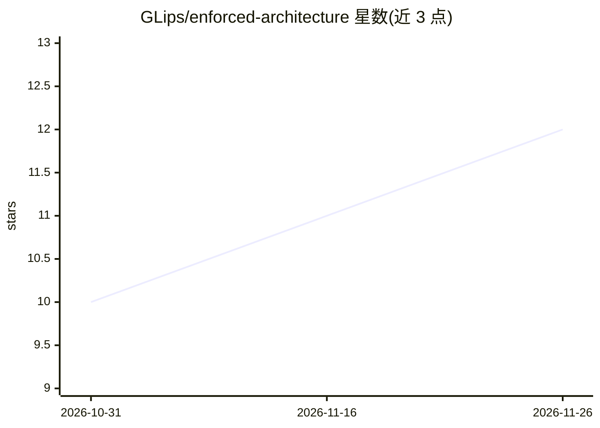

# GLips/enforced-architecture

⭐ 12 · TypeScript · 推送 2026-11-10 · [GitHub](https://github.com/GLips/enforced-architecture) · 个人维护

**用 lint 规则约束 AI 编码代理的 TypeScript 架构规范目录**

面向 TypeScript 代码库的架构约束规则目录，提供 11 个类别共数十条 lint 规则，用于在 AI 代理生成代码时阻断违反分层与依赖方向的写法。规则分为 per-file（oxlint 插件、实时运行）与 structural（提交前全树检查）两档，错误信息即修复指令，多数规则为阻断而非警告。支持两种用法：直接让编码代理读取本仓库仿写规则，或通过 npx 安装 skill 复制规则；完整适配目标栈为 TanStack Start + Drizzle + oxlint，其他栈需翻译实现。

## 筛选速览

| 维度 | 判定 | 备注 |
|---|---|---|
| AI 角色 | `ai-ecosystem` | LLM/agent 周边工具 |
| 许可风险 | `none` | — |
| 部署形态 | `library` | 以包/库形式分发 |
| 模型依赖 | — | README 未给出锁定关系 |
| 硬件要求 | — | 无带数字的原话,不猜 |
| 安装摩擦 | `low` | 无编译、无系统依赖或容器化 |
| 成熟度 | — | 结构信号不足 |

## 能力要点

- 11 个类别共数十条现成 lint 规则，含边界、类型、放置、命名等
- 错误信息即修复指令，代理可自行纠正无需人工介入
- per-file 规则实时运行，structural 规则在提交前做全树依赖图检查
- 提供 npx skills add 方式安装为 agent 技能

## 适用场景

- 让编码代理在团队约定的架构边界内写代码
- 为 TypeScript 项目快速搭建分层与导入限制的 lint 防线
- 把规则作为菜单参考，让代理为其他技术栈仿写等效规则

## 场景标签

`编码 Agent` · 领域:编码与开发

## 证据(README 行号)

> L1: Enforced Architecture—lint rules that stop AI agents from turning your codebase into slop soup.
> L5: A catalog of dozens of ready-to-steal enforcement rules for TypeScript codebases. Steal them, or point your coding a
> L28: npx skills add GLips/enforced-architecture

## 星数曲线

2026-10-31 10 → 2026-11-26 12（+2）

---
*卡片 v1 · prompt 1.4 · 生成 2026-11-19 · 置信度 high · 依据 README sha `8754deeea12f` · [字段定义](../../DATASET.md)*
