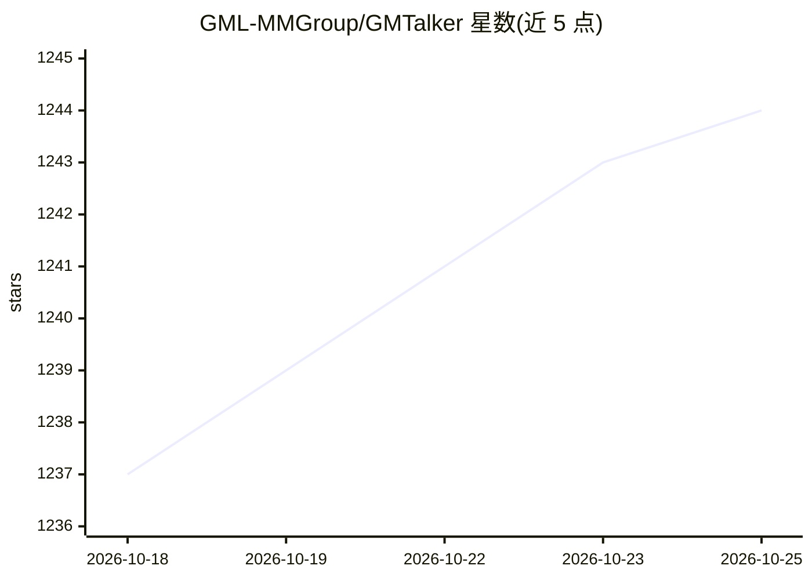

# GML-MMGroup/GMTalker

⭐ 1,244 · Python · NOASSERTION · 推送 2026-01-08 · [GitHub](https://github.com/GML-MMGroup/GMTalker) · 组织维护 · 中文 README

**UE5 渲染的 3D 数字人系统：语音识别/合成/NLU/嘴型驱动一体化**

由光明实验室媒体智能团队开发的交互式 3D 数字人系统，基于 Unreal Engine 渲染，集成语音识别（FunASR/ONNX Runtime）、语音合成（MeloTTS）、自然语言理解与唇形动画驱动。支持 Windows/Linux/Android 部署，可完全离线流式对话；最低 2GB 显存即可运行整个项目，支持华为昇腾 NPU 与纯 CPU 模式。后端提供 Docker 与 WebUI 一键启动，UE 项目打包为独立可执行文件。许可为 CC BY-NC 4.0（非商业）。

## 筛选速览

| 维度 | 判定 | 备注 |
|---|---|---|
| AI 角色 | `ai-native` | 本体是模型或模型工具 |
| 许可风险 | `none` | NOASSERTION |
| 部署形态 | `desktop` | 安装包/桌面程序 |
| 模型依赖 | — | README 未给出锁定关系 |
| 硬件要求 | `cpu-ok` | |
| 安装摩擦 | `low` | 无编译、无系统依赖或容器化 |
| 成熟度 | — | 结构信号不足 |

## 能力要点

- UE5 渲染的 3D 数字人形象，含唇形同步与微表情
- 集成语音识别、语音合成、自然语言理解与嘴型动画驱动
- 全离线流式对话，支持唤醒、打断与语音克隆
- 支持 Windows/Linux/Android，最低 2GB 显存或纯 CPU 运行

## 适用场景

- 部署一个可语音交互的 3D 数字人做展示或导览
- 基于 LLM 或本地知识库定制数字人对话能力
- 在无网络的本地环境运行实时语音对话数字人

## 场景标签

`语音 Agent` · 领域:对话与助手

## 证据(README 行号)

> L21: **GMTalker**​​, an interactive digital human rendered by Unreal Engine, is developed by the Media Intelligence Team
> L43: - 🗓️ **2025.10.10**:It now offers comprehensive support for both GPU and NPU 910B servers. The FunASR speech recogn

## 星数曲线

2026-10-18 1,237 → 2026-10-25 1,244（+7）

---
*卡片 v1 · prompt 1.4 · 生成 2026-10-21 · 置信度 high · 依据 README sha `11dc178dfb8c` · [字段定义](../../DATASET.md)*
