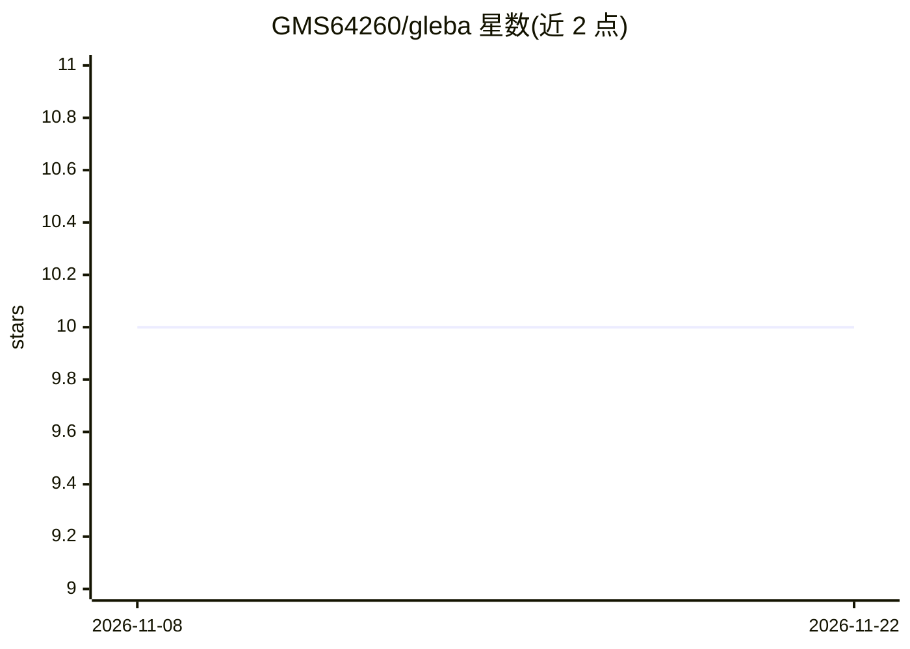

# GMS64260/gleba

⭐ 10 · TypeScript · NOASSERTION · 推送 2026-11-21 · [GitHub](https://github.com/GMS64260/gleba) · [官网](https://gleba.fr/) · 个人维护

**面向小型农场的开源农场管理软件，内置 AI 助手与 MCP 服务器**

面向菜农、果农、养殖户、微型农场与教学农园的 Web 农场管理应用，覆盖种植规划、播种/收获日历、2D/3D 地块绘图、库存、天气、溯源、记账、商店等功能；内置 135+ 物种、154 条技术路线及 FranceAgriMer 2026 价格数据。支持 Docker 或 Debian/Ubuntu 自托管（PostgreSQL+PostGIS）。通过 MCP 服务器提供 39 个工具，可用自然语言从 Claude Desktop/Claude Code/ChatGPT 等客户端操作农场数据。托管版基础免费，付费档位增加 AI 助手、天气、商店等模块。

## 筛选速览

| 维度 | 判定 | 备注 |
|---|---|---|
| AI 角色 | `ai-enhanced` | 去掉 AI 部分产品仍成立 |
| 许可风险 | `viral` | NOASSERTION |
| 部署形态 | `self-host` | docker 或自建部署 |
| 模型依赖 | — | README 未给出锁定关系 |
| 硬件要求 | — | 无带数字的原话,不猜 |
| 安装摩擦 | `low` | 无编译、无系统依赖或容器化 |
| 成熟度 | — | 结构信号不足 |

## 能力要点

- MCP 服务器提供 39 个工具，支持自然语言操作农场数据
- 135+ 物种、154 条技术路线，数据源自 FranceAgriMer 2026 与 ITAB
- 2D/3D 地块可视化与自动灌溉规划
- 记账、发票、TVA 与 FEC 导出等农场经营管理功能

## 适用场景

- 自托管管理多样化小农场的种植、养殖与库存
- 通过 Claude 或 ChatGPT 用自然语言记录收获、查询经营数据
- 规划播种/收获日历并进行产品价值核算

## 场景标签

 · 领域:农业/农场管理

## 证据(README 行号)

> L18: **Gleba** est une application web de gestion agricole pour les maraîchers, arboriculteurs, éleveurs, micro-fermes, 
> L62: - **Assistant IA** - Questions en langage naturel et aide contextualisée selon la configuration
> L269: Gleba intègre un serveur MCP (Model Context Protocol) avec **39 outils** permettant de piloter votre ferme depuis 

## 星数曲线

2026-11-08 10 → 2026-11-22 10（+0）

---
*卡片 v1 · prompt 1.4 · 生成 2026-11-20 · 置信度 mid · 依据 README sha `a0c9099f8220` · [字段定义](../../DATASET.md)*
