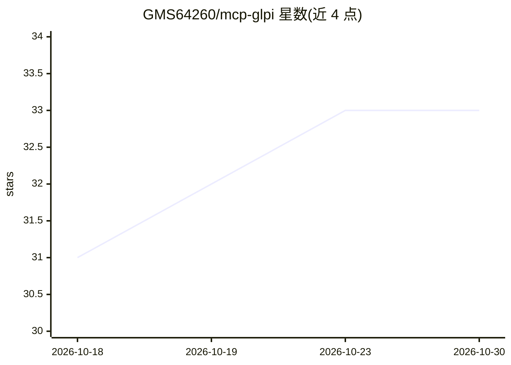

# GMS64260/mcp-glpi

⭐ 33 · TypeScript · MIT · 推送 2026-10-21 · [GitHub](https://github.com/GMS64260/mcp-glpi) · 个人维护

**连接 GLPI ITSM 的 MCP 服务器：给 AI 助手 46 个运维工具**

面向 GLPI（开源 IT 服务管理套件）的 Model Context Protocol 服务器，供 Claude Desktop、Claude Code、Cursor、Open WebUI 等 MCP 客户端调用：提供 46 个工具、9 个工具集，覆盖工单与时间线、问题、变更、审批、资产（24 种条目类型）、用户组、知识库、多条件搜索与报表。输出为适配模型上下文窗口的紧凑 JSON，写工具带注解且可用单变量切换只读模式，v3 的 50 个工具名保留为隐藏别名。支持 stdio 与 Streamable HTTP 两种传输，npm 分发，需 Node.js 20+ 与开启 REST API 的 GLPI 10/11 实例。

## 筛选速览

| 维度 | 判定 | 备注 |
|---|---|---|
| AI 角色 | `ai-ecosystem` | LLM/agent 周边工具 |
| 许可风险 | `permissive` | MIT |
| 部署形态 | `self-host` | docker 或自建部署 |
| 模型依赖 | — | README 未给出锁定关系 |
| 硬件要求 | — | 无带数字的原话,不猜 |
| 安装摩擦 | `low` | 无编译、无系统依赖或容器化 |
| 成熟度 | — | 结构信号不足 |

## 能力要点

- 46 个工具、9 个工具集覆盖工单/问题/变更/资产/知识库/搜索
- GLPI_READ_ONLY 一变量切换只读模式，写工具带 destructiveHint 注解
- 支持 stdio 与 Streamable HTTP 双传输，兼容多种 MCP 客户端
- 输出为面向模型上下文窗口优化的紧凑 JSON

## 适用场景

- 让 Claude/Cursor 等 AI 助手直接查询和处理 GLPI 工单
- 在 Open WebUI 中接入 GLPI 资产与知识库问答
- 通过对话完成工单创建、指派、跟进与审批操作

## 场景标签

 · 领域:IT 服务管理/AI 工具接入

## 证据(README 行号)

> L3: A Model Context Protocol server for
> L6: WebUI, any MCP client) 46 tools over the GLPI REST API: tickets and their

## 星数曲线

2026-10-18 31 → 2026-10-30 33（+2）

---
*卡片 v1 · prompt 1.4 · 生成 2026-10-25 · 置信度 high · 依据 README sha `43591504bf29` · [字段定义](../../DATASET.md)*
