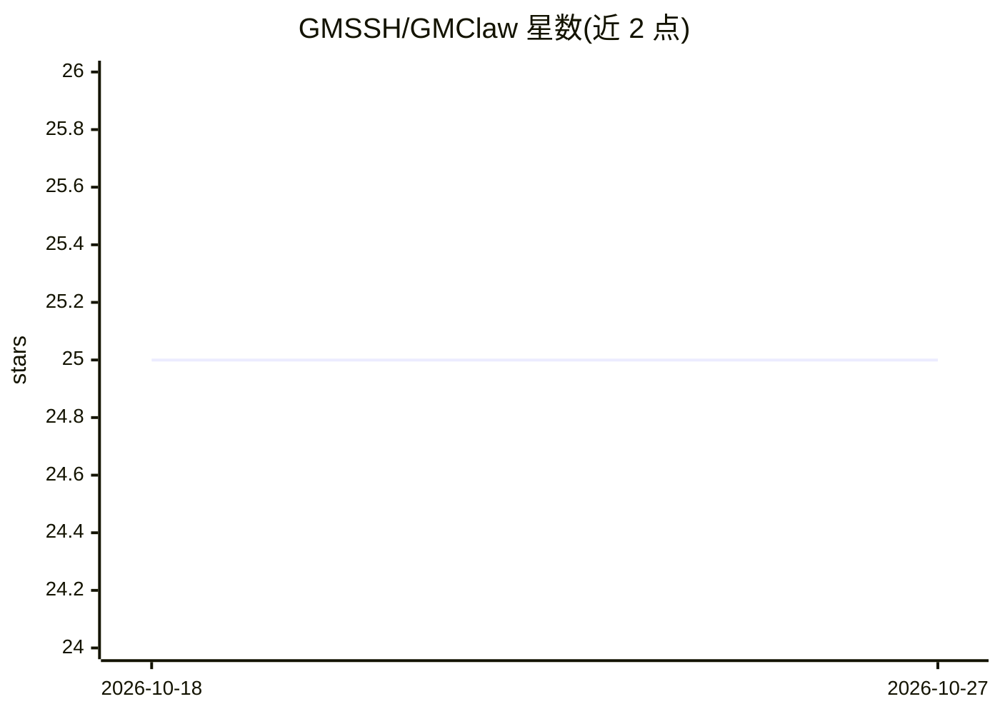

# GMSSH/GMClaw

⭐ 25 · Vue · AGPL-3.0 · 推送 2026-03-17 · [GitHub](https://github.com/GMSSH/GMClaw) · [官网](https://www.gmssh.com/?ks=Github) · 组织维护 · 中文 README

**个人 AI 助手/Agent 的可视化管理面板，基于 GMSSH 生态**

基于 GMSSH 生态的一体化 AI agent 管理应用：通过 Web 桌面与客户端的应用中心一键安装，以图形界面管理 OpenClaw 类 agent 的部署（支持 Docker 容器与原生 Shell 脚本两种模式，含环境自检与自动补全依赖）。功能覆盖网关监控、模型 API 可视化配置（如 DeepSeek-Chat，含 128K 上下文与输出限制设置）、Agent 人格编辑、WeCom/QQ/钉钉/飞书多渠道接入、51+ 内置技能与技能市场、Cron 定时任务。源码可二次开发（Go 后端 + pnpm 前端），GPL-3.0 许可。

## 筛选速览

| 维度 | 判定 | 备注 |
|---|---|---|
| AI 角色 | `ai-ecosystem` | LLM/agent 周边工具 |
| 许可风险 | `viral` | AGPL-3.0 |
| 部署形态 | `library` | 以包/库形式分发 |
| 模型依赖 | — | README 未给出锁定关系 |
| 硬件要求 | — | 无带数字的原话,不猜 |
| 安装摩擦 | `low` | 无编译、无系统依赖或容器化 |
| 成熟度 | — | 结构信号不足 |

## 能力要点

- Docker 与 Shell 脚本双部署模式，含依赖自动检测补全
- 模型 API、Agent 人格的可视化配置中心
- WeCom/QQ/钉钉/飞书多渠道 IM 图形化接入
- 51+ 内置技能、技能市场与 Cron 定时任务管理

## 适用场景

- 在 Linux 服务器上以图形界面部署和管理 AI agent
- 无需编辑配置文件即可接入企业微信/QQ/钉钉/飞书
- 通过定时任务自动触发 Agent 行为（如晨间摘要）

## 场景标签

`AI 助手` `Agent 框架` `工作流自动化` · 领域:Agent 开发

## 证据(README 行号)

> L11: OpenClaw-Turbo dramatically simplifies the deployment and management of AI agents.
> L12: Whether you are a performance-focused source-build enthusiast or a container-first DevOps engineer, OpenClaw-Turbo 
> L64: Dual Installation Modes
> L65: - Fully supports： **Docker container deployment** and Supports **native Shell script build deployment**

## 星数曲线

2026-10-18 25 → 2026-10-27 25（+0）

---
*卡片 v1 · prompt 1.4 · 生成 2026-10-27 · 置信度 mid · 依据 README sha `fd694b7cbe8c` · [字段定义](../../DATASET.md)*
