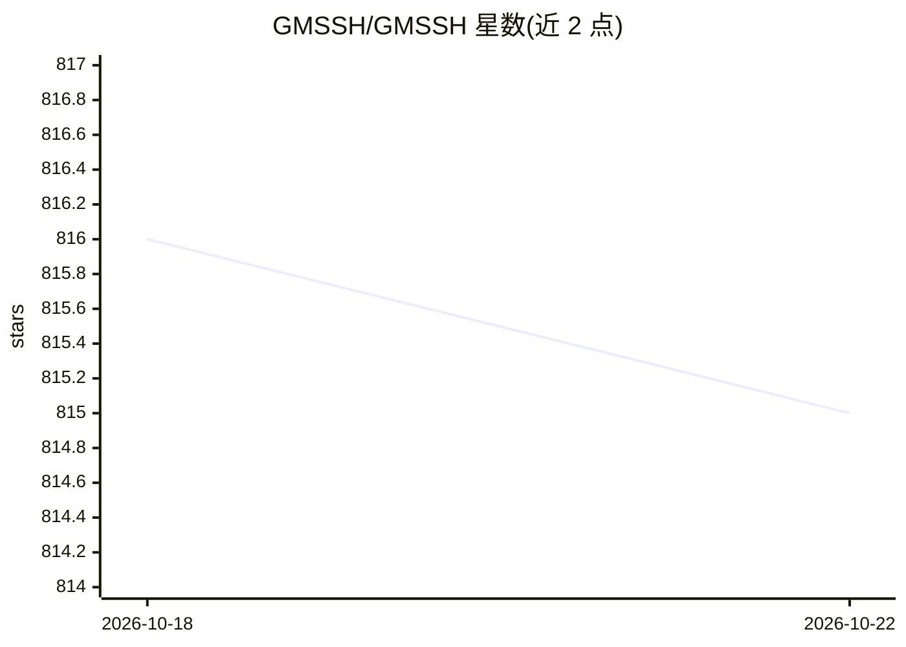

# GMSSH/GMSSH

⭐ 815 · Go · 推送 2026-10-15 · [GitHub](https://github.com/GMSSH/GMSSH) · [官网](https://www.gmssh.com/) · 组织维护 · 中文 README

**基于 SSH 的 Linux 服务器桌面工作区，带 GMAI 辅助运维**

构建在 SSH 之上的桌面化 Linux 服务器管理平台：连接服务器后可在类 Windows 桌面中使用文件管理、SFTP 传输、多窗口终端、服务器浏览器、任务/进程检查与资源监控，并支持多服务器分组、搜索、切换与批量执行。GMAI 提供命令解释、脚本生成、日志配置分析与故障排查，支持自定义模型、AI Skills 与知识库。服务器端无需安装完整桌面环境或常驻面板，通信走 SSH 隧道。提供浏览器版、桌面客户端与企业私有部署三种使用方式。

## 筛选速览

| 维度 | 判定 | 备注 |
|---|---|---|
| AI 角色 | `ai-enhanced` | 去掉 AI 部分产品仍成立 |
| 许可风险 | `none` | — |
| 部署形态 | `None` |  |
| 模型依赖 | — | README 未给出锁定关系 |
| 硬件要求 | — | 无带数字的原话,不猜 |
| 安装摩擦 | `low` | 无编译、无系统依赖或容器化 |
| 成熟度 | — | 结构信号不足 |

## 能力要点

- SSH 之上提供文件/终端/浏览器/应用的桌面工作区，无需服务器端桌面环境
- GMAI 支持命令解释、脚本生成、日志分析与自定义模型、AI Skills、知识库
- 多服务器分组、标签、搜索、批量命令执行
- Application Center、Docker 管理与开放插件系统，支持自托管部署

## 适用场景

- 在一个工作区里管理多台 Linux 服务器的连接与日常操作
- 不熟悉命令行的用户以可视化方式使用 Linux 服务器
- 让 AI 解释命令、分析日志并辅助排查服务器问题

## 场景标签

 · 领域:运维/服务器管理工具

## 证据(README 行号)

> L22: It does not require a full desktop environment or an additional server control panel to be installed on the server.
> L101: GMAI can help explain commands, generate scripts, analyze logs and configuration, troubleshoot common problems, an
> L164: - AI conversations and command explanations

## 星数曲线

2026-10-18 816 → 2026-10-22 815（-1）

---
*卡片 v1 · prompt 1.4 · 生成 2026-10-21 · 置信度 high · 依据 README sha `01707494d7c4` · [字段定义](../../DATASET.md)*
