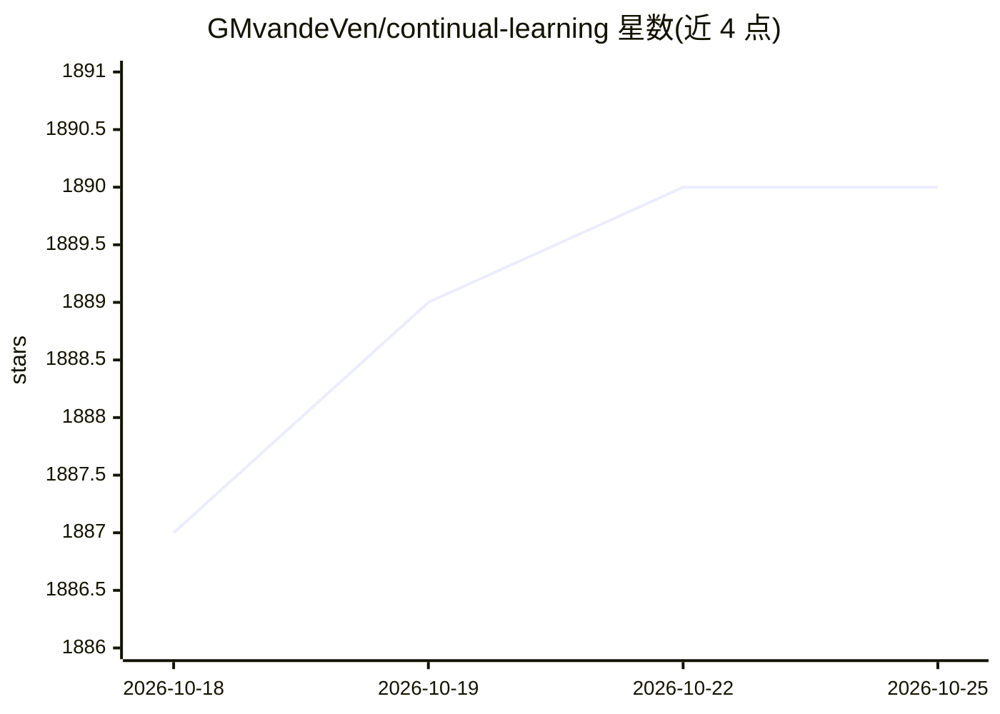

# GMvandeVen/continual-learning

⭐ 1,890 · Jupyter Notebook · MIT · 推送 2025-11-05 · [GitHub](https://github.com/GMvandeVen/continual-learning) · 个人维护

**多种持续学习方法的 PyTorch 实现库，供研究者跑实验**

基于 PyTorch 的持续学习实验代码库，实现 XdG、EWC、SI、LwF、FROMP、DGR、BI-R、ER、A-GEM、iCaRL、生成式分类器等 12 种方法，支持任务增量、域增量、类增量三种场景，覆盖 Split MNIST/permMNIST/CIFAR10/CIFAR100 数据集。主要面向学术持续学习设定，另提供 task-free 变体脚本与 NeurIPS 2022 教程、ICLR 2025 博文的复现实验。代码无需安装，通过 pip 安装 requirements.txt 依赖后直接运行 main.py，支持方法组合与 visdom 实时曲线。

## 筛选速览

| 维度 | 判定 | 备注 |
|---|---|---|
| AI 角色 | `ai-native` | 本体是模型或模型工具 |
| 许可风险 | `permissive` | MIT |
| 部署形态 | `library` | 以包/库形式分发 |
| 模型依赖 | — | README 未给出锁定关系 |
| 硬件要求 | — | 无带数字的原话,不猜 |
| 安装摩擦 | `low` | 无编译、无系统依赖或容器化 |
| 成熟度 | — | 结构信号不足 |

## 能力要点

- 12 种持续学习方法的统一实现与命令行开关
- task/domain/class 三种增量场景与四种基准数据集
- task-free 设定支持（模糊边界/随机流切换）
- 提供论文表格与图表的完整复现脚本 all_results.sh

## 适用场景

- 对比不同持续学习方法在三种场景下的表现
- 复现 Nature MI 论文与 NeurIPS 教程中的实验
- 基于现有方法组件组合自定义持续学习策略

## 场景标签

`科研工具` · 领域:学习与行业

## 证据(README 行号)

> L4: This is a PyTorch implementation of the continual learning experiments with deep neural networks described in the
> L89: - Separate Networks: `./main.py --separate-networks`

## 星数曲线

2026-10-18 1,887 → 2026-10-25 1,890（+3）

---
*卡片 v1 · prompt 1.4 · 生成 2026-10-21 · 置信度 mid · 依据 README sha `d0948eff72f0` · [字段定义](../../DATASET.md)*
