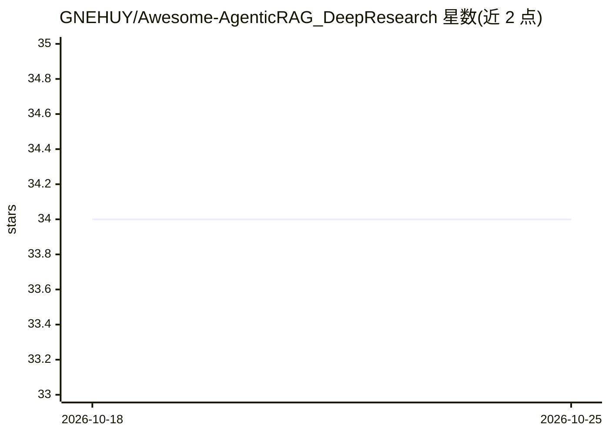

# GNEHUY/Awesome-AgenticRAG_DeepResearch

⭐ 34 · JavaScript · 推送 2026-07-23 · [GitHub](https://github.com/GNEHUY/Awesome-AgenticRAG_DeepResearch) · 个人维护 · 中文 README

**Agentic RAG 与 DeepResearch 论文策展清单（2025 年起）**

按时间线（2025.01–2025.10）收录 Agentic RAG、检索增强推理与 DeepResearch 领域论文的 Awesome 清单：每条给出论文标题、arXiv 链接、中文方法摘要，多数条目附代码仓库链接。内容集中于用强化学习训练搜索代理、过程奖励设计、查询增强与内外部知识协同等方向，面向该方向的研究者与学习者作为文献索引使用。仓库本身不提供代码或安装方式。

## 筛选速览

| 维度 | 判定 | 备注 |
|---|---|---|
| AI 角色 | `ai-knowledge` | 知识聚合/清单类 |
| 许可风险 | `none` | — |
| 部署形态 | `None` |  |
| 模型依赖 | — | README 未给出锁定关系 |
| 硬件要求 | — | 无带数字的原话,不猜 |
| 安装摩擦 | `low` | 无编译、无系统依赖或容器化 |
| 成熟度 | — | 结构信号不足 |

## 能力要点

- 收录 Search-o1、Search-R1、DeepResearcher 等 2025 年系列论文
- 每条含 arXiv 链接与中文方法摘要
- 多数条目附对应代码仓库链接

## 适用场景

- 跟踪 Agentic RAG 与 DeepResearch 的最新论文进展
- 查找可复现的搜索代理训练代码仓库
- 了解强化学习在检索增强推理中的应用脉络

## 场景标签

`精选清单` `科研工具` · 领域:学习与行业

## 证据(README 行号)

> L1: Awesome-AgenticRAG_DeepResearch
> L5: 🔬 列举一些关于AgenticRAG、DeepResearch的系列文章，以2025年开始，包括Search-O1，Search-R1
> L7: - [2025.01] [[Search-o1]](https://arxiv.org/abs/2501.05366) Search-o1: Agentic Search-Enhanced Large Reasoning Model

## 星数曲线

2026-10-18 34 → 2026-10-25 34（+0）

---
*卡片 v1 · prompt 1.4 · 生成 2026-10-25 · 置信度 high · 依据 README sha `a1a218b0f419` · [字段定义](../../DATASET.md)*
