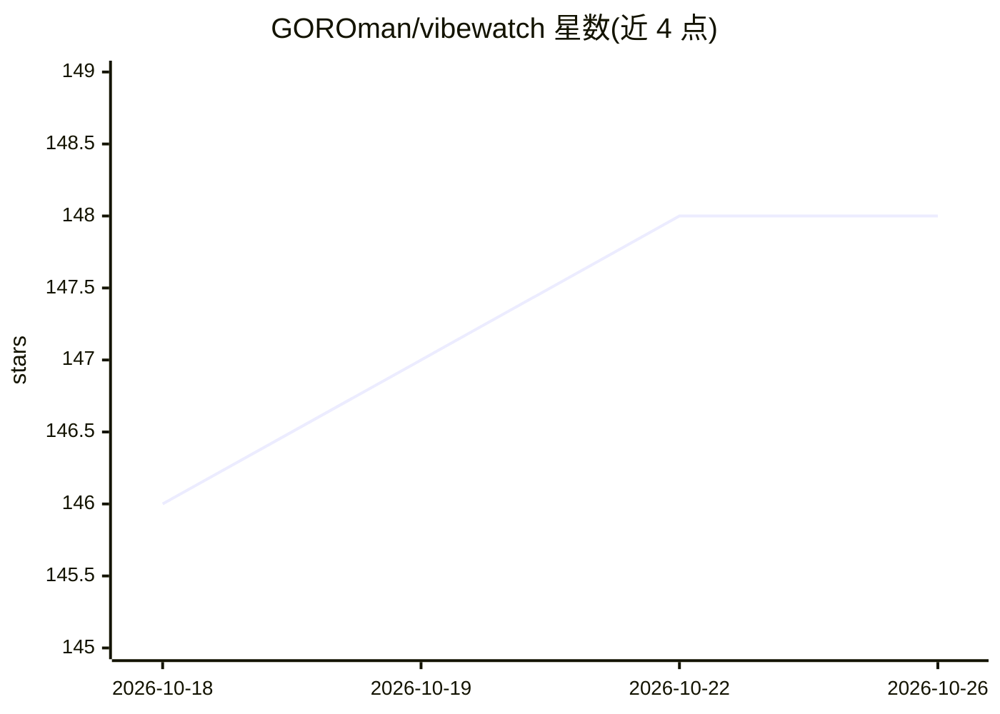

# GOROman/vibewatch

⭐ 148 · C++ · MIT · 推送 2026-08-08 · [GitHub](https://github.com/GOROman/vibewatch) · 个人维护 · 中文 README

**给 Vibe Coding 开发者的 M5Stack 可穿戴 AI 会话控制器**

运行在 M5Stack StopWatch（ESP32-S3）上的固件，将并行 AI agent 会话的控制从桌面 UI 移到腕上设备：Agent 层以环形界面显示六个 agent 状态，Action 层通过物理按键提供 OK/NG 审批、Plan 模式切换、助手调用与按住说话，经 BLE HID 与 macOS 主机通信，配合声音、振动与触觉反馈。README 提供基于 PlatformIO 的源码构建与上传步骤，并说明用官方手表配件改装为腕戴的方法，改装需剪切工具。

## 筛选速览

| 维度 | 判定 | 备注 |
|---|---|---|
| AI 角色 | `ai-ecosystem` | LLM/agent 周边工具 |
| 许可风险 | `permissive` | MIT |
| 部署形态 | `None` |  |
| 模型依赖 | — | README 未给出锁定关系 |
| 硬件要求 | — | 无带数字的原话,不猜 |
| 安装摩擦 | `low` | 无编译、无系统依赖或容器化 |
| 成熟度 | — | 结构信号不足 |

## 能力要点

- 六个并行 agent 状态的环形界面与快速切换
- 物理按键实现 OK/NG 审批、Plan 模式与按住说话
- 通过 BLE HID 与主机配对，声音/振动多感官反馈
- 提供 M5Stack 手表配件的腕戴改装步骤与照片

## 适用场景

- 并行运行多个 AI agent 会话时在腕上查看状态并审批/拒绝
- 离开键盘时通过语音与按键继续操作 AI 助手
- Maker 自行构建并改装为腕戴控制器

## 场景标签

 · 领域:硬件/人机交互

## 证据(README 行号)

> L21: Vibe Watch moves frequent AI-agent interactions away from crowded desktop UI and onto a dedicated wireless device. 
> L29: After purchasing an OpenAI Codex Micro, I was inspired by the idea of dedicated hardware for AI coding. I believed 

## 星数曲线

2026-10-18 146 → 2026-10-26 148（+2）

---
*卡片 v1 · prompt 1.4 · 生成 2026-10-22 · 置信度 mid · 依据 README sha `faf5a187b7d2` · [字段定义](../../DATASET.md)*
