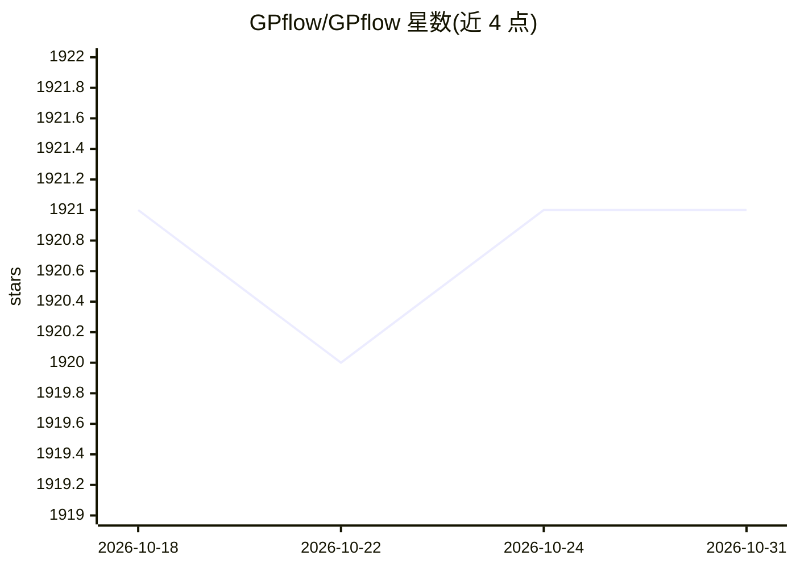

# GPflow/GPflow

⭐ 1,921 · Python · Apache-2.0 · 推送 2026-10-15 · [GitHub](https://github.com/GPflow/GPflow) · 组织维护

**基于 TensorFlow 的高斯过程建模 Python 库**

GPflow 是用 Python 构建高斯过程模型的库，实现可组合核与似然的现代高斯过程推断，基于 TensorFlow 2.4+ 与 TensorFlow Probability 运行计算，可在 GPU 上快速执行。由最初作者 James Hensman 等创建，现由多位维护者及社区维护。通过 PyPI 或源码安装，支持 Python ≥ 3.7；已停止基于 TensorFlow 1 的版本支持（最后为 v1.5.1）。README 列出 Trieste、VFF 等基于其构建的项目，并有 JMLR 论文可供引用。

## 筛选速览

| 维度 | 判定 | 备注 |
|---|---|---|
| AI 角色 | `ai-native` | 本体是模型或模型工具 |
| 许可风险 | `permissive` | Apache-2.0 |
| 部署形态 | `library` | 以包/库形式分发 |
| 模型依赖 | — | README 未给出锁定关系 |
| 硬件要求 | — | 无带数字的原话,不猜 |
| 安装摩擦 | `low` | 无编译、无系统依赖或容器化 |
| 成熟度 | — | 结构信号不足 |

## 能力要点

- 可组合核与似然的高斯过程推断
- 基于 TensorFlow 2.4+ 与 TensorFlow Probability，支持 GPU 执行
- 提供变分推断与 MCMC 等主题（仓库标签）相关能力
- 配套论文（JMLR 2017 与 arXiv 多输出框架）可引用

## 适用场景

- 在 Python 中构建和训练高斯过程回归/分类模型
- 做贝叶斯机器学习研究（变分推断、MCMC）
- 作为基础库被贝叶斯优化等下游项目（如 Trieste）使用

## 场景标签

 · 领域:机器学习/概率建模

## 证据(README 行号)

> L14: GPflow is a package for building Gaussian process models in Python.
> L17: GPflow builds on TensorFlow 2.4+ and TensorFlow Probability for running computations, which allows fast execution o

## 星数曲线

2026-10-18 1,921 → 2026-10-31 1,921（+0）

---
*卡片 v1 · prompt 1.4 · 生成 2026-10-21 · 置信度 high · 依据 README sha `11c8bf5603e4` · [字段定义](../../DATASET.md)*
