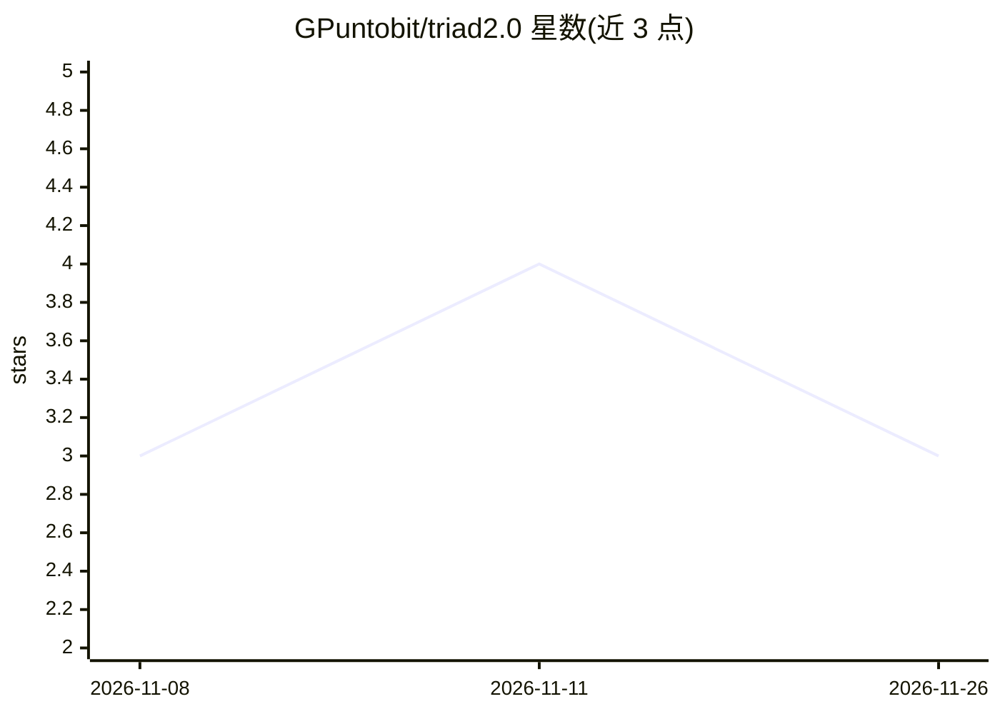

# GPuntobit/triad2.0

⭐ 3 · Shell · MIT · 推送 2026-11-12 · [GitHub](https://github.com/GPuntobit/triad2.0) · 个人维护

**独立编程语言：规范+一致性测试+编辑器工具链**

Triad 2.0 是一门独立编程语言，语法特性包括块结构、声明类型、多重派发、集成逻辑编程（事实/规则/回溯/合一）与代码即数据；语言定义由独立于实现的规范文档（SPEC.md）与可执行一致性测试套件（conformance/）构成。运行时为机器码种子（Windows x86-64 PE 与 Linux x86-64 ELF），不依赖 Julia 或任何宿主语言，安装仅需 POSIX shell；提供 VS Code、Vim/Neovim 编辑器支持与 .triad 扩展。完整语言（Triad-Full）尚未全部实现，仅 Core 42/42 通过。

## 筛选速览

| 维度 | 判定 | 备注 |
|---|---|---|
| AI 角色 | `ai-enhanced` | 去掉 AI 部分产品仍成立 |
| 许可风险 | `permissive` | MIT |
| 部署形态 | `desktop` | 安装包/桌面程序 |
| 模型依赖 | — | README 未给出锁定关系 |
| 硬件要求 | — | 无带数字的原话,不猜 |
| 安装摩擦 | `low` | 无编译、无系统依赖或容器化 |
| 成熟度 | `idea` | |

## 能力要点

- 独立于宿主语言的机器码种子运行时（PE/ELF，约 8.6 KB 静态 ELF）
- 规范驱动：normative spec + golden 一致性测试（Core 42/42 字节级通过）
- 内置逻辑编程引擎（合一、回溯、递归规则）
- 提供 LLM 代码生成基准目录（系统提示与自动验证器）

## 适用场景

- 学习一门带逻辑编程与多重派发特性的语言
- 基于规范与一致性测试实现语言处理器
- 用 LLM 基准评估 Triad 代码生成质量

## 场景标签

 · 领域:编程语言/开发工具

## 证据(README 行号)

> L56: - **AI:** ai/ — benchmark for Triad code generation by LLMs, with
> L175:  Execution requires an x86-64 platform (Windows PE or Linux ELF seed).

## 星数曲线

2026-11-08 3 → 2026-11-26 3（+0）

---
*卡片 v1 · prompt 1.4 · 生成 2026-11-21 · 置信度 mid · 依据 README sha `61d31ea16921` · [字段定义](../../DATASET.md)*
