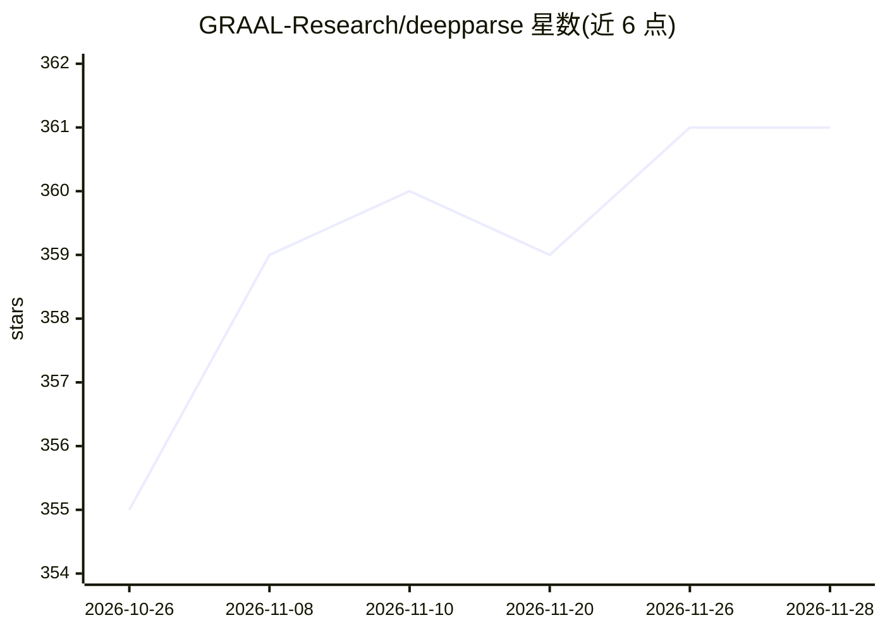

# GRAAL-Research/deepparse

⭐ 361 · Python · MIT · 推送 2026-11-02 · [GitHub](https://github.com/GRAAL-Research/deepparse) · [官网](https://deepparse.org/) · 组织维护

**深度学习地址解析库：解析多国街道地址成分**

Deepparse 是一个用深度学习解析多国街道地址的 Python 库，基于 PyTorch 构建，要求 Python 3.10–3.14。提供预训练模型（FastText、BPEmb、Model2Vec 及其带注意力机制版本），可将地址拆分为门牌号、街道名、单元、城市、省份、邮编等标签；支持命令行解析、FastAPI REST 服务部署、在新数据上重训练模型、自定义预测标签、从零训练 Seq2Seq 模型。附 20 国训练数据准确率与 41 国零样本评估表，模型权重可经 CLI、HuggingFace 或 GitHub Release 下载。

## 筛选速览

| 维度 | 判定 | 备注 |
|---|---|---|
| AI 角色 | `ai-native` | 本体是模型或模型工具 |
| 许可风险 | `permissive` | MIT |
| 部署形态 | `self-host` | docker 或自建部署 |
| 模型依赖 | — | README 未给出锁定关系 |
| 硬件要求 | — | 无带数字的原话,不猜 |
| 安装摩擦 | `low` | 无编译、无系统依赖或容器化 |
| 成熟度 | — | 结构信号不足 |

## 能力要点

- 预训练模型解析地址为结构化标签，支持带/不带注意力机制
- CLI 命令行解析与 FastAPI 开箱 REST API（Docker Compose 部署）
- 支持在新数据上重训练、冻结部分层、自定义标签与 Seq2Seq 从零训练
- 提供 20 国训练评估与 41 国零样本评估结果表

## 适用场景

- 批量解析客户/订单数据中的多国地址为结构化字段
- 部署 REST 服务为业务系统提供地址解析接口
- 针对特定国家的地址格式重训练模型

## 场景标签

`模型训练` · 领域:训练与推理

## 证据(README 行号)

> L24: Deepparse is a state-of-the-art library for parsing multinational street addresses using deep learning.
> L28: - parse multinational address using one of our pretrained models with or without attention mechanism,
> L38: Deepparse is compatible with the __latest version of PyTorch__ and __Python >= 3.10, <= 3.14__.

## 星数曲线

2026-10-26 355 → 2026-11-28 361（+6）

---
*卡片 v1 · prompt 1.4 · 生成 2026-11-25 · 置信度 high · 依据 README sha `6c0baf3ed2f8` · [字段定义](../../DATASET.md)*
