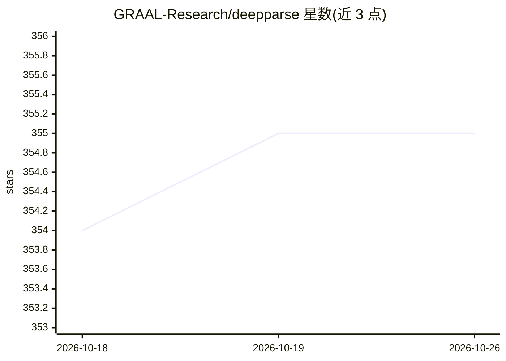

# GRAAL-Research/deepparse

⭐ 355 · Python · LGPL-3.0 · 推送 2026-10-25 · [GitHub](https://github.com/GRAAL-Research/deepparse) · [官网](https://deepparse.org/) · 组织维护

**用深度学习解析多国街道地址的 Python 库**

提供预训练 Seq2Seq 模型（FastText/BPEmb 及带注意力版本）解析多国街道地址，输出门牌、街道、市镇、邮编等 8 类标签；在 20 个训练国家公布准确率，并对 41 国做零样本评测。支持命令行解析、FastAPI+Docker 开箱即用 API，可在新数据上重训、冻结层、自定义标签或从零训练 Seq2Seq 模型。兼容最新版 PyTorch 与 Python 3.10-3.13；LGPL v3 许可，附 DOI 与论文引用。

## 筛选速览

| 维度 | 判定 | 备注 |
|---|---|---|
| AI 角色 | `ai-native` | 本体是模型或模型工具 |
| 许可风险 | `viral` | LGPL-3.0 |
| 部署形态 | `self-host` | docker 或自建部署 |
| 模型依赖 | — | README 未给出锁定关系 |
| 硬件要求 | — | 无带数字的原话,不猜 |
| 安装摩擦 | `low` | 无编译、无系统依赖或容器化 |
| 成熟度 | — | 结构信号不足 |

## 能力要点

- 预训练 FastText/BPEmb/注意力模型解析多国地址，20 训练国 + 41 国零样本评测
- 命令行 parse 与 download_model 工具，无需写代码即可解析
- FastAPI + Docker Compose 开箱即用解析服务，可接 Sentry 监控
- 支持重训、冻结层、自定义标签、从零训练 Seq2Seq 模型

## 适用场景

- 批量解析多国街道地址为结构化字段
- 部署地址解析 REST API 服务
- 在特定国家地址数据上重训模型以适配本地格式

## 场景标签

 · 领域:NLP/地址结构化

## 证据(README 行号)

> L24: Deepparse is a state-of-the-art library for parsing multinational street addresses using deep learning.
> L28: - parse multinational address using one of our pretrained models with or without attention mechanism,

## 星数曲线

2026-10-18 354 → 2026-10-26 355（+1）

---
*卡片 v1 · prompt 1.4 · 生成 2026-10-21 · 置信度 high · 依据 README sha `eac9b17b0d25` · [字段定义](../../DATASET.md)*
