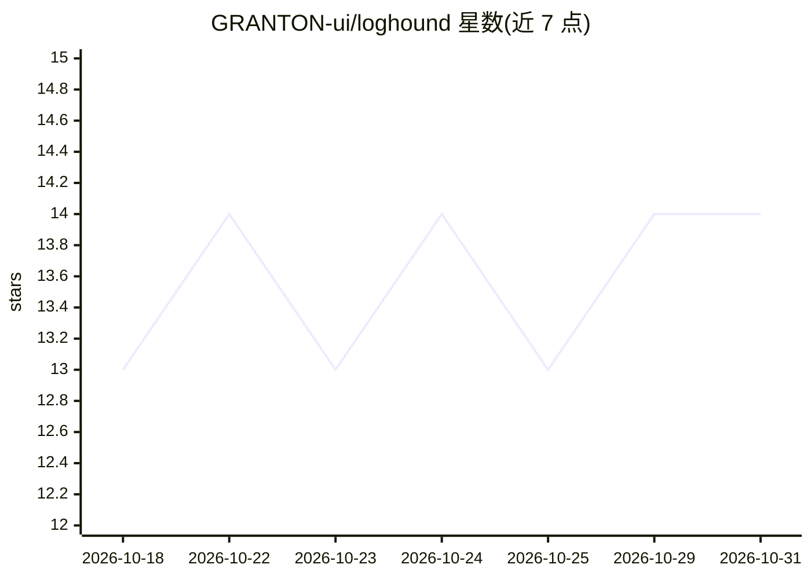

# GRANTON-ui/loghound

⭐ 14 · TypeScript · Apache-2.0 · 推送 2026-06-28 · [GitHub](https://github.com/GRANTON-ui/loghound) · 组织维护

**AI 日志诊断引擎：分析日志与堆栈，定位根因并给出修复建议**

面向开发者、SRE 与网络安全学习者的日志分析工具：解析应用、数据库、容器或服务器原始日志，结合上传的代码库文件，定位错误发生的文件与行号，输出严重性分级、根因分析与修复建议（含代码片段）。管道使用 Google Gemini 与 OpenRouter API，发送前用正则自动清除日志中的密码、凭据与 API key。以 Streamlit 本地 Web 应用形式运行，需 Python 3.12+ 与 Gemini 或 OpenAI API key。当前为 v0.1.0-alpha 活跃开发阶段，VS Code 插件、CLI 与本地 LLM 支持列为规划中。

## 筛选速览

| 维度 | 判定 | 备注 |
|---|---|---|
| AI 角色 | `ai-native` | 本体是模型或模型工具 |
| 许可风险 | `permissive` | Apache-2.0 |
| 部署形态 | `library` | 以包/库形式分发 |
| 模型依赖 | locked-api |  |
| 硬件要求 | — | 无带数字的原话,不猜 |
| 安装摩擦 | `low` | 无编译、无系统依赖或容器化 |
| 成熟度 | `idea` | |

## 能力要点

- 定位错误到文件路径、行号、函数与上下文
- 多格式日志解析：多行日志、容器崩溃、数据库锁、原始 traceback
- 四级严重性分级（Critical/High/Medium/Low）
- 发送 API 前自动清除密码、凭据与 API key
- 一键导出 Markdown 诊断报告

## 适用场景

- 把生产环境堆栈跟踪粘贴进来快速定位根因
- 结合代码库文件做行级错误定位与修复建议
- 为事件工单生成结构化诊断报告

## 场景标签

 · 领域:开发者工具/可观测性

## 证据(README 行号)

> L9: LogHound is an AI-powered log analysis tool for developers, SREs, and cybersecurity students. By parsing raw applica
> L40: - `server.ts` manages the Express server, static assets, and the SRE cooperative analysis pipeline with Google Gemi

## 星数曲线

2026-10-18 13 → 2026-10-31 14（+1）

---
*卡片 v1 · prompt 1.4 · 生成 2026-10-31 · 置信度 mid · 依据 README sha `1fe659ecc14d` · [字段定义](../../DATASET.md)*
