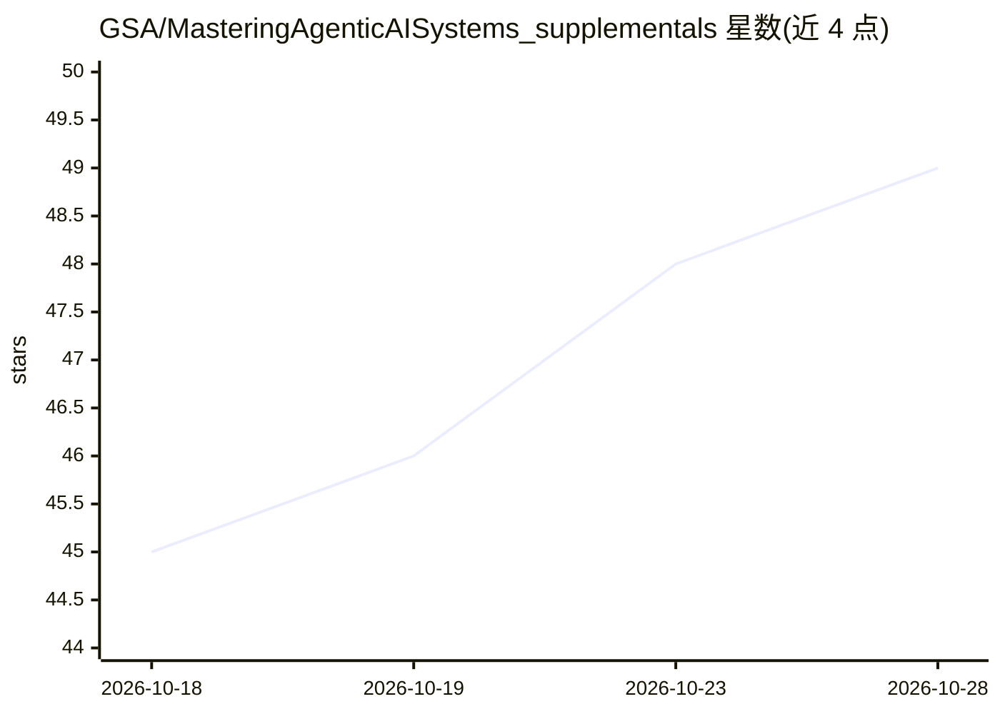

# GSA/MasteringAgenticAISystems_supplementals

⭐ 49 · Python · NOASSERTION · 推送 2026-10-28 · [GitHub](https://github.com/GSA/MasteringAgenticAISystems_supplementals) · [官网](https://gsa.github.io/MasteringAgenticAISystems_supplementals/) · 组织维护

**面向多厂商 Agentic AI 认证考试的公开学习指南与配套资料库**

美国总务署（GSA）发布的《Mastering Agentic AI Systems》图书配套仓库，主要支持 NVIDIA NCP-AAI 认证备考，亦覆盖 AWS AIP-C01、Databricks GenAI Engineer Associate、Google Cloud PMLE、Microsoft AI-102。内容按 10 部分、约 94 章组织，提供章节正文、先修知识清单、章节到认证知识项的映射（每认证一份 CSV 及 H/M/L/N 相关度评级）、测验与模拟考试链接（外部 Google Forms）、幻灯片、代码示例与第三方视频索引。labs/ 动手实验正在重建，目前仅有模板与一个参考实验，17 个归档文件为含代码的正文摘录而非成品实验。以 CC0 公共领域方式发布，公开征集贡献者。

## 筛选速览

| 维度 | 判定 | 备注 |
|---|---|---|
| AI 角色 | `ai-knowledge` | 知识聚合/清单类 |
| 许可风险 | `none` | NOASSERTION |
| 部署形态 | `None` |  |
| 模型依赖 | — | README 未给出锁定关系 |
| 硬件要求 | — | 无带数字的原话,不猜 |
| 安装摩擦 | `low` | 无编译、无系统依赖或容器化 |
| 成熟度 | — | 结构信号不足 |

## 能力要点

- 章节到认证知识项的映射（每认证一份 CSV，H/M/L/N 相关度评级）
- 10 部分、约 94 章正文加先修知识、难度分类、测验与模拟考试链接
- 每章节幻灯片（PDF）与独立代码示例
- CC0 公共领域发布，公开征集实验编写与内容审校

## 适用场景

- 备考 NVIDIA NCP-AAI 或 AWS/Databricks/Google/Microsoft 相关认证
- 讲授或自建覆盖 agentic AI 系统的课程时用作教材底稿
- 按目标认证的知识项清单筛选优先复习章节

## 场景标签

`教程课程` · 领域:学习与行业

## 证据(README 行号)

> L3: Companion material for *Mastering Agentic AI Systems: Guide for the NVIDIA NCP-AAI
> L28: |`cert_mapping/`|Chapter-to-certification knowledge-item mappings (H/M/L/N relevance ratings), one CSV per certific

## 星数曲线

2026-10-18 45 → 2026-10-28 49（+4）

---
*卡片 v1 · prompt 1.4 · 生成 2026-10-25 · 置信度 high · 依据 README sha `3242f805bfff` · [字段定义](../../DATASET.md)*
