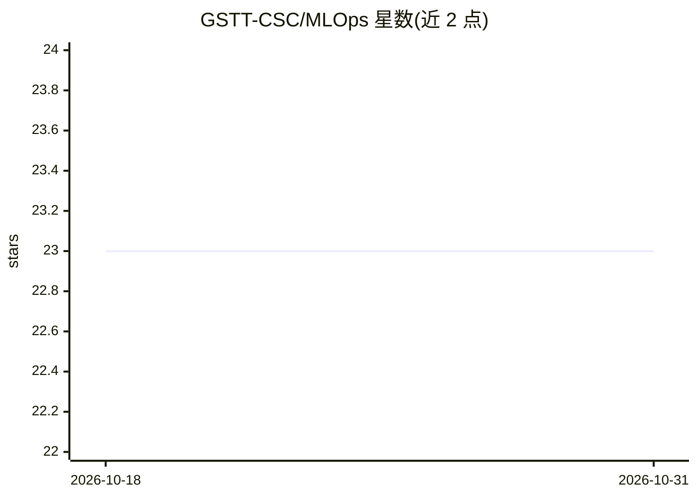

# GSTT-CSC/MLOps

⭐ 23 · Python · GPL-3.0 · 推送 2026-10-05 · [GitHub](https://github.com/GSTT-CSC/MLOps) · 组织维护

**面向医疗 AI 项目的持续集成与部署 MLOps 框架**

由 GSTT-CSC（医院临床科学计算团队）维护的医疗场景 MLOps 框架，含三部分：MLOps 服务器（Docker Compose 编排 MLFlow、MINIO、NGINX、Postgres 四容器，提供实验跟踪与模型服务）、项目模板（起点工程）以及 PyPI 上的 csc-mlops Python 包（负责项目与服务器通信、Docker 镜像构建、项目注册等自动化任务）。README 提示 MINIO 即将移除待更新，并警告 MLFlow 公开实例模型反序列化风险。

## 筛选速览

| 维度 | 判定 | 备注 |
|---|---|---|
| AI 角色 | `ai-ecosystem` | LLM/agent 周边工具 |
| 许可风险 | `viral` | GPL-3.0 |
| 部署形态 | `self-host` | docker 或自建部署 |
| 模型依赖 | — | README 未给出锁定关系 |
| 硬件要求 | — | 无带数字的原话,不猜 |
| 安装摩擦 | `low` | 无编译、无系统依赖或容器化 |
| 成熟度 | `idea` | |

## 能力要点

- Docker Compose 一键部署 MLFlow/MINIO/NGINX/Postgres 四容器服务
- csc-mlops Python 包自动执行项目注册、Docker 镜像构建与服务器通信
- 基于 MLflow 的实验跟踪，将运行与 git commit 关联实现可复现
- 支持 XNAT 作为数据归档平台，可适配其他数据存储

## 适用场景

- 医疗 AI 团队搭建可管控的模型开发与实验跟踪平台
- 将训练运行与代码版本关联以保证可复现性
- 在隔离网络上部署 ML 生命周期管理服务

## 场景标签

`MLOps` · 领域:训练与推理

## 证据(README 行号)

> L18: This project aims to build an effective MLOps framework for the development of AI models in a healthcare setting. T
> L20: The MLOps server hosts the ML lifecycle management services. An MLFlow instance serves as the management platform, 

## 星数曲线

2026-10-18 23 → 2026-10-31 23（+0）

---
*卡片 v1 · prompt 1.4 · 生成 2026-10-27 · 置信度 high · 依据 README sha `e25f53b3e4c0` · [字段定义](../../DATASET.md)*
