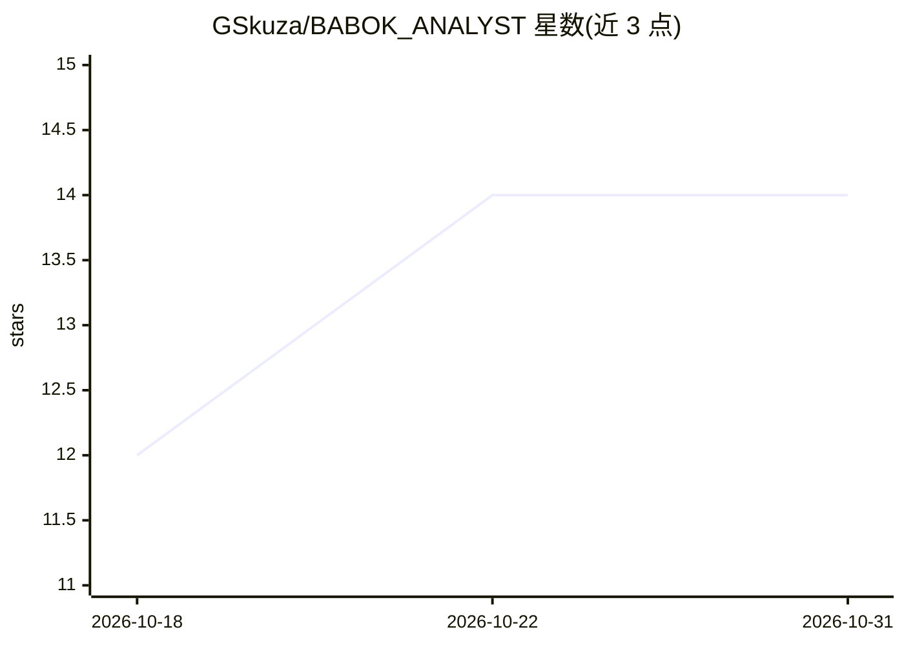

# GSkuza/BABOK_ANALYST

⭐ 14 · JavaScript · NOASSERTION · 推送 2026-10-29 · [GitHub](https://github.com/GSkuza/BABOK_ANALYST) · 个人维护

**遵循 BABOK v3 的 AI 商业分析代理，引导分析师走 9 阶段流程**

一套面向 AI 模型（Claude、ChatGPT 等 LLM）的系统提示词与工具集，将模型转变为符合 BABOK v3 标准的商业分析专家。默认 babok 档案按 Stage 0 项目章程到 Stage 8 商业案例/ROI 共 9 个阶段推进，每阶段需人工批准（human-in-the-loop），采用简短结论+引证的方法论，生成 Markdown 项目文档并持久化项目日志。另提供 consulting 与 software-development 档案（后者可连接 GitHub/GitLab 仓库构建证据基线）。面向中型 IT 项目的业务分析师。可通过 Claude Code/Codex/Copilot CLI 插件市场安装，或粘贴提示词至 claude.ai 使用，含 Next.js Web UI、MCP 服务器（19 工具+9 资源）与 CLI。

## 筛选速览

| 维度 | 判定 | 备注 |
|---|---|---|
| AI 角色 | `ai-native` | 本体是模型或模型工具 |
| 许可风险 | `none` | NOASSERTION |
| 部署形态 | `library` | 以包/库形式分发 |
| 模型依赖 | — | README 未给出锁定关系 |
| 硬件要求 | — | 无带数字的原话,不猜 |
| 安装摩擦 | `low` | 无编译、无系统依赖或容器化 |
| 成熟度 | — | 结构信号不足 |

## 能力要点

- BABOK v3 合规的 9 阶段结构化分析流程（含章程门与 ROI 模型）
- 每阶段人工批准（human-in-the-loop）与持久化项目日志
- 19 个 MCP 工具 + 9 个阶段资源，含编排器与 12 个分阶段子代理
- 内置 Next.js Web UI：仪表盘、AI 访谈、审批/修订控制与 ZIP 导出

## 适用场景

- 我在中型公司做 IT 项目时，让 AI 引导我完成从章程到商业案例的全流程分析
- 通过 Claude Code/Codex 插件或 claude.ai 项目直接使用业务分析代理
- 连接现有仓库，生成证据支撑的软件现代化基线与实施计划

## 场景标签

`提示工程` · 领域:Agent 开发

## 证据(README 行号)

> L6: An AI agent for professional business analysis compliant with **BABOK v3** (International Institute of Business Anal
> L12: BABOK Analyst is a set of system prompts for AI models (Claude, ChatGPT, other LLMs) that transforms them into busi
> L16: - Requires **human approval** at each stage (human-in-the-loop)

## 星数曲线

2026-10-18 12 → 2026-10-31 14（+2）

---
*卡片 v1 · prompt 1.4 · 生成 2026-10-31 · 置信度 high · 依据 README sha `97d798912f5e` · [字段定义](../../DATASET.md)*
