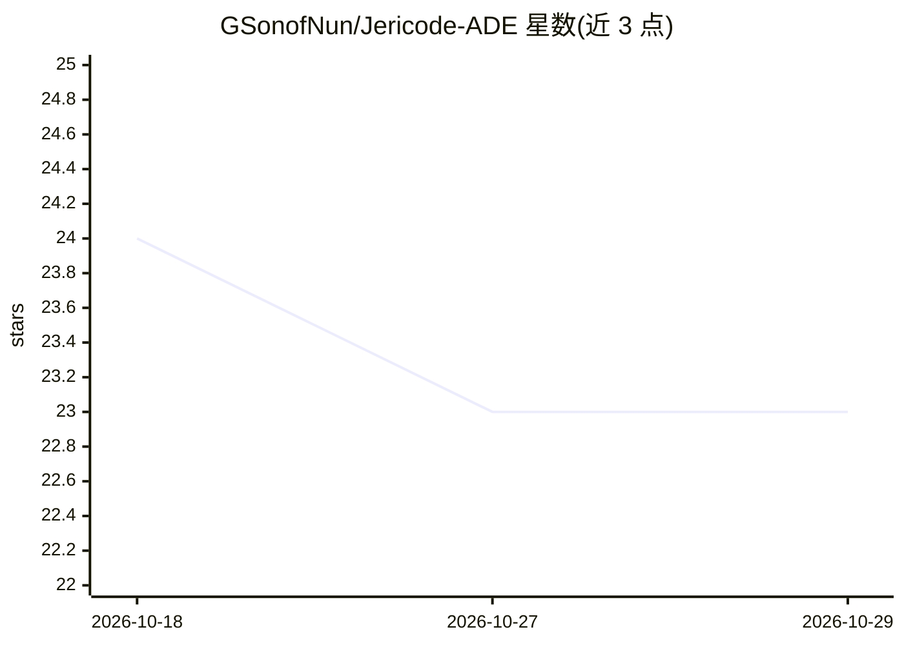

# GSonofNun/Jericode-ADE

⭐ 23 · 推送 2026-05-14 · [GitHub](https://github.com/GSonofNun/Jericode-ADE) · [官网](https://apps.microsoft.com/detail/9N3W6PQ7X087) · 个人维护

**Claude Code 与 Codex CLI 的 Windows 原生桌面客户端**

基于 WinUI 3 的 Windows 桌面应用，为 Claude Code（Anthropic）与 Codex（OpenAI）两类终端编码代理提供图形界面：实时流式响应与 token 计数、并排文件 diff、按会话切换供应商并独立配置、会话创建/恢复/分叉、工具权限可视化审批、token 与费用跟踪、子代理活动监控。需本机预装至少一个 CLI 供应商并通过其账号认证，数据全部本地存储。从 Microsoft Store 或 GitHub Releases 获取 MSIX 安装包。

## 筛选速览

| 维度 | 判定 | 备注 |
|---|---|---|
| AI 角色 | `ai-ecosystem` | LLM/agent 周边工具 |
| 许可风险 | `none` | — |
| 部署形态 | `library` | 以包/库形式分发 |
| 模型依赖 | locked-api |  |
| 硬件要求 | — | 无带数字的原话,不猜 |
| 安装摩擦 | `low` | 无编译、无系统依赖或容器化 |
| 成熟度 | `idea` | |

## 能力要点

- 同一界面按会话切换 Claude 与 Codex，独立配置
- 工具权限可视化审批（含风险指示）与计划模式预览
- token 与费用按轮/按会话跟踪并可设预算上限
- 会话持久化、恢复与分叉，子代理并行活动实时监控

## 适用场景

- 不想在终端里使用 Claude Code 或 Codex，改用桌面图形界面
- 在同一应用中管理 Claude 与 Codex 两类编码代理的会话
- 对 AI 的工具调用逐项审批并跟踪用量与费用

## 场景标签

`编码 Agent` · 领域:编码与开发

## 证据(README 行号)

> L3:  A native Windows desktop client for Claude Code and Codex CLI.
> L15: - **Multi-provider** — Switch between Claude and Codex per session with independent configuration
> L41: Jericode requires at least one of the following CLI tools installed on your system.

## 星数曲线

2026-10-18 24 → 2026-10-29 23（-1）

---
*卡片 v1 · prompt 1.4 · 生成 2026-10-27 · 置信度 mid · 依据 README sha `e335ecd24478` · [字段定义](../../DATASET.md)*
