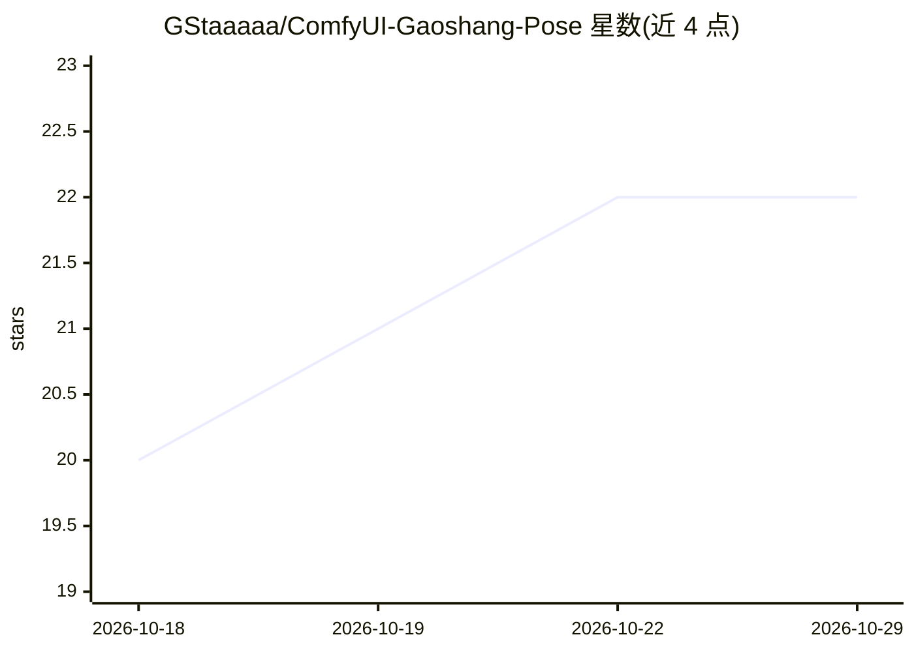

# GStaaaaa/ComfyUI-Gaoshang-Pose

⭐ 22 · JavaScript · NOASSERTION · 推送 2026-09-29 · [GitHub](https://github.com/GStaaaaa/ComfyUI-Gaoshang-Pose) · 个人维护 · 中文 README

**ComfyUI 多人姿势编辑器节点：1–9 人独立摆姿接入 Qwen 图像编辑**

ComfyUI 自定义节点，提供最多 9 人的独立姿势编辑器：彩色编号切换角色，支持关节调整、站位移动、键盘转身与视角旋转，内置 209 张 OpenPose 骨架图一键摆姿，可导入自定义骨架。姿势参考图与 1–9 张人物图按编号接入 Qwen Image 2.1 图像编辑工作流，自动生成身份与姿势对应提示词。需要支持 TextEncodeQwenImage21 的 ComfyUI 版本与 WebGL 浏览器；不包含模型权重，无严格锁定输出人数与身份的机制。

## 筛选速览

| 维度 | 判定 | 备注 |
|---|---|---|
| AI 角色 | `ai-ecosystem` | LLM/agent 周边工具 |
| 许可风险 | `permissive` | NOASSERTION |
| 部署形态 | `library` | 以包/库形式分发 |
| 模型依赖 | — | README 未给出锁定关系 |
| 硬件要求 | — | 无带数字的原话,不猜 |
| 安装摩擦 | `low` | 无编译、无系统依赖或容器化 |
| 成熟度 | `idea` | |

## 能力要点

- 1–9 人独立摆姿，彩色编号切换，9 张人物参考图按编号对应
- 209 张 OpenPose 骨架图一键摆姿，支持导入/保存/读取姿势
- 移动/调关节/旋转视角三种模式，键盘控制转身与前后移动
- 附带机位姿态节点、Qwen2.1 编码节点与 GGUF CLIP 加载器

## 适用场景

- 在 ComfyUI 中编排多人构图与剧情站位的生成工作流
- 为 Qwen Image 2.1 图像编辑提供姿势与身份参考图
- 用现成 OpenPose 骨架快速起摆多人姿势

## 场景标签

`图像生成` · 领域:内容生成

## 证据(README 行号)

> L6: 在 ComfyUI 中摆好人物动作、转身和站位，再将姿势参考图接入 Qwen Image 2.1 图像编辑工作流。
> L30: git clone https://github.com/GStaaaaa/ComfyUI-Gaoshang-Pose.git
> L64: 1. 连接 `clip`、`vae` 和 **1号人物图片**，点击 **“打开高尚姿势编辑器”**。

## 星数曲线

2026-10-18 20 → 2026-10-29 22（+2）

---
*卡片 v1 · prompt 1.4 · 生成 2026-10-27 · 置信度 mid · 依据 README sha `507c4329e452` · [字段定义](../../DATASET.md)*
