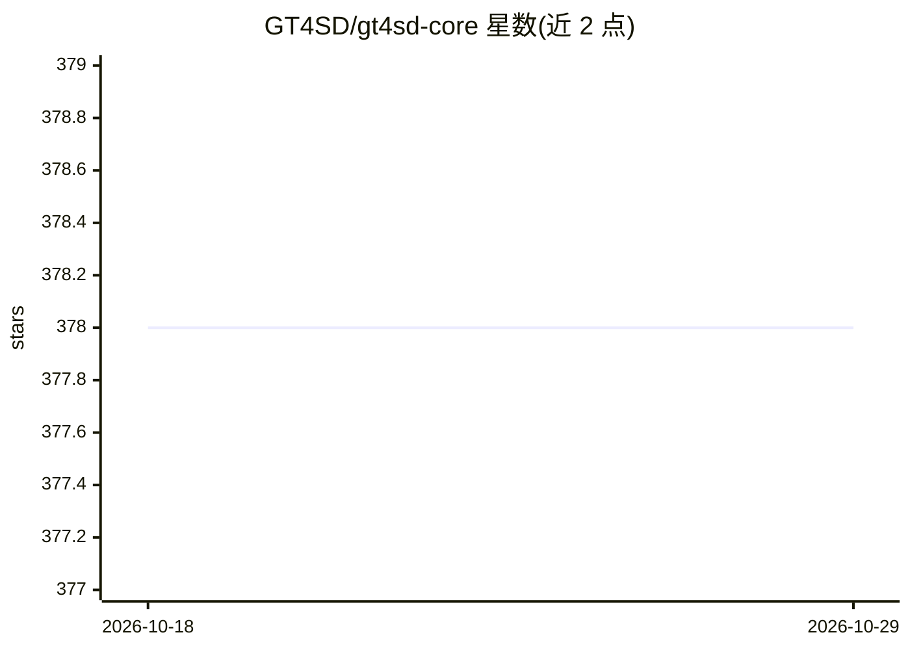

# GT4SD/gt4sd-core

⭐ 378 · Jupyter Notebook · MIT · 推送 2026-09-10 · [GitHub](https://github.com/GT4SD/gt4sd-core) · [官网](https://gt4sd.github.io/gt4sd-core/) · 组织维护

**科学发现生成式模型工具库：统一推理/训练/属性预测流程**

面向科学发现的开源 Python 库，聚合多个生成式模型包（PaccMann、GuacaMol、Moses、TorchDrug、MoLeR、transformers、diffusers、GFlowNets 等），提供统一高层 API 运行推理与训练管线。功能包括：gt4sd-inference CLI 直接跑推理、gt4sd-trainer 支持约 10 类训练管线、gt4sd-saving/gt4sd-upload 保存并上传训练模型到公共 hub 或自建 COS，另含属性预测子模块。推荐 conda 环境安装，python>=3.7,<=3.10，部分依赖需 Git LFS。

## 筛选速览

| 维度 | 判定 | 备注 |
|---|---|---|
| AI 角色 | `ai-ecosystem` | LLM/agent 周边工具 |
| 许可风险 | `permissive` | MIT |
| 部署形态 | `self-host` | docker 或自建部署 |
| 模型依赖 | — | README 未给出锁定关系 |
| 硬件要求 | — | 无带数字的原话,不猜 |
| 安装摩擦 | `low` | 无编译、无系统依赖或容器化 |
| 成熟度 | — | 结构信号不足 |

## 能力要点

- 统一 API 封装 10+ 个生成式模型包的推理与训练管线
- CLI 三件套：gt4sd-inference / gt4sd-trainer / gt4sd-saving+upload
- PropertyPredictorRegistry 计算生成样本的分子/材料属性
- 预训练模型在 Hugging Face Spaces 以 gradio 应用提供

## 适用场景

- 在 Python 或 CLI 中调用预训练生成模型做分子/材料假设生成
- 训练并保存自己的生成模型用于后续推理管线
- 对生成样本计算属性并按目标属性筛选

## 场景标签

`模型训练` `推理引擎` · 领域:训练与推理

## 证据(README 行号)

> L18: The **GT4SD** (Generative Toolkit for Scientific Discovery) is an open-source platform to accelerate hypothesis gen
> L231: Beyond implementing various generative modeling inference and training pipelines GT4SD is designed to provide a hi

## 星数曲线

2026-10-18 378 → 2026-10-29 378（+0）

---
*卡片 v1 · prompt 1.4 · 生成 2026-10-21 · 置信度 high · 依据 README sha `849beef4ba17` · [字段定义](../../DATASET.md)*
