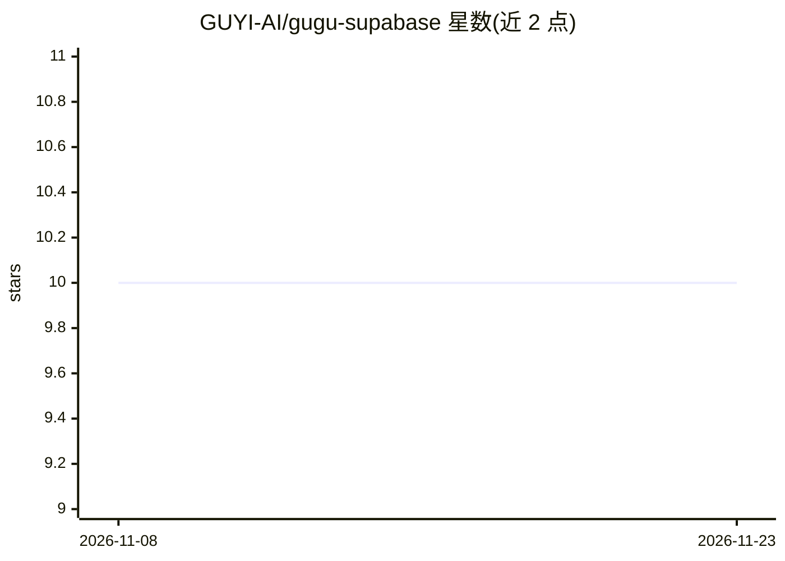

# GUYI-AI/gugu-supabase

⭐ 10 · PLpgSQL · NOASSERTION · 推送 2026-11-22 · [GitHub](https://github.com/GUYI-AI/gugu-supabase) · [官网](https://gugu.nextmind.space) · 组织维护

**为 Gugu 社区客户端提供自托管 Supabase 后端**

Gugu 社区版后端，部署在用户自己的 Supabase 项目上，提供身份认证、消息、同步、设备通信、权限与基础文件服务。安装工具按版本顺序以事务方式执行 SQL 迁移并记录安装台账，权限由数据库 RLS/Auth 触发器/Storage 策略强制执行。签署邮件验证码登录需自配 SMTP；托管多租户运营需商业许可。AI 模型由客户端用用户自己的 Claude 账户或 API key 配置，后端不含模型网关。

## 筛选速览

| 维度 | 判定 | 备注 |
|---|---|---|
| AI 角色 | `ai-enhanced` | 去掉 AI 部分产品仍成立 |
| 许可风险 | `permissive` | NOASSERTION |
| 部署形态 | `library` | 以包/库形式分发 |
| 模型依赖 | — | README 未给出锁定关系 |
| 硬件要求 | — | 无带数字的原话,不猜 |
| 安装摩擦 | `low` | 无编译、无系统依赖或容器化 |
| 成熟度 | — | 结构信号不足 |

## 能力要点

- 一键式安装工具：校验空项目、事务化安装基础迁移并按序安装后续版本
- 权限全部由数据库层强制（RLS、Auth 触发器、Realtime 授权、Storage 策略）
- 文件服务含上传/签名下载、传输预算与独立 Node 协同编辑服务
- 本地 Docker 化测试数据库用于客户端-后端契约验证

## 适用场景

- 为 Gugu 客户端搭建社区自托管后端
- 在自有 Supabase 项目中管理身份、消息与文件权限
- 本地验证客户端与后端的契约一致性

## 场景标签

 · 领域:后端基础设施

## 证据(README 行号)

> L5: The community backend of Gugu: identity, messaging, sync, device communication, permissions and basic file services,
> L21: The tool checks that the project is empty, installs the foundation in one transaction and then the later releases i

## 星数曲线

2026-11-08 10 → 2026-11-23 10（+0）

---
*卡片 v1 · prompt 1.4 · 生成 2026-11-20 · 置信度 mid · 依据 README sha `16051a46b8b8` · [字段定义](../../DATASET.md)*
