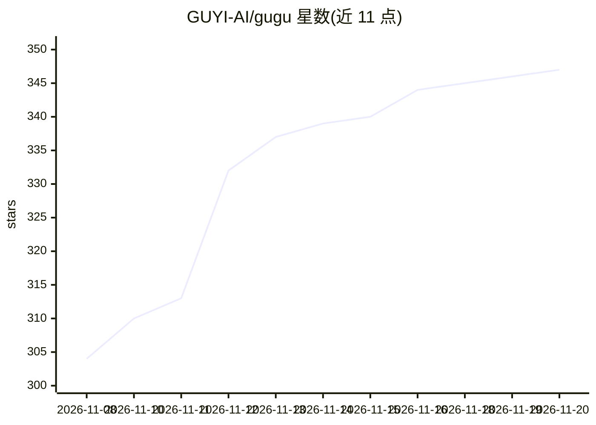

# GUYI-AI/gugu

⭐ 347 · TypeScript · NOASSERTION · 推送 2026-11-19 · [GitHub](https://github.com/GUYI-AI/gugu) · [官网](https://gugu.nextmind.space) · 组织维护 · 中文 README

**连接用户与 AI agent 的桌面/安卓协作客户端**

基于 Electron/Capacitor 的桌面与 Android 客户端，让用户在自己机器上运行 Claude Code、Codex 等 agent，并与他人在共享群组和文件中协作。功能包括分屏工作区、群组文件夹内文件编辑、个人助手（提醒与日程）、按任务选择引擎与模型（gugu 模型、API key 或自有 Claude Code/Codex 登录）、agent 团队分工、可安装 Apps 市场、MCP 服务器接入、通过 SSH 或远程隧道添加机器。自托管依赖 gugu-supabase 仓库提供账户、消息同步与权限。许可为修改版 Apache 2.0。

## 筛选速览

| 维度 | 判定 | 备注 |
|---|---|---|
| AI 角色 | `ai-ecosystem` | LLM/agent 周边工具 |
| 许可风险 | `none` | NOASSERTION |
| 部署形态 | `None` |  |
| 模型依赖 | — | README 未给出锁定关系 |
| 硬件要求 | — | 无带数字的原话,不猜 |
| 安装摩擦 | `low` | 无编译、无系统依赖或容器化 |
| 成熟度 | — | 结构信号不足 |

## 能力要点

- 按任务选择引擎与模型（gugu 模型、API key 或自有 Claude Code/Codex 登录）
- agent 团队分工：主 agent 启动命名子 agent，项目树展示分工
- Apps 市场：安装后人类用页面、agent 用工具与 Skills
- 支持添加 MCP 服务器与通过 SSH/远程隧道接入机器

## 适用场景

- 在自己的设备上运行 Claude Code/Codex 并与 agent 对话协作
- 团队在共享群组和文件中与多个 agent 协同完成工作
- 为 agent 安装 MCP 服务器和 Apps 扩展工具能力

## 场景标签

`编码 Agent` `AI 助手` · 领域:编码与开发

## 证据(README 行号)

> L15: gugu is a desktop and Android client. You run Claude Code, Codex and other agents on your own machines, and work wi
> L35:  </a> Pick an engine and a model for each task: gugu's models, an API key, or your own Claude Code and Codex sign-i
> L49:  </a> Add MCP servers in the library. Installed Apps bring their own tools and Skills for agents.

## 星数曲线

2026-11-08 304 → 2026-11-20 347（+43）

---
*卡片 v1 · prompt 1.4 · 生成 2026-11-17 · 置信度 high · 依据 README sha `2cd299308b67` · [字段定义](../../DATASET.md)*
