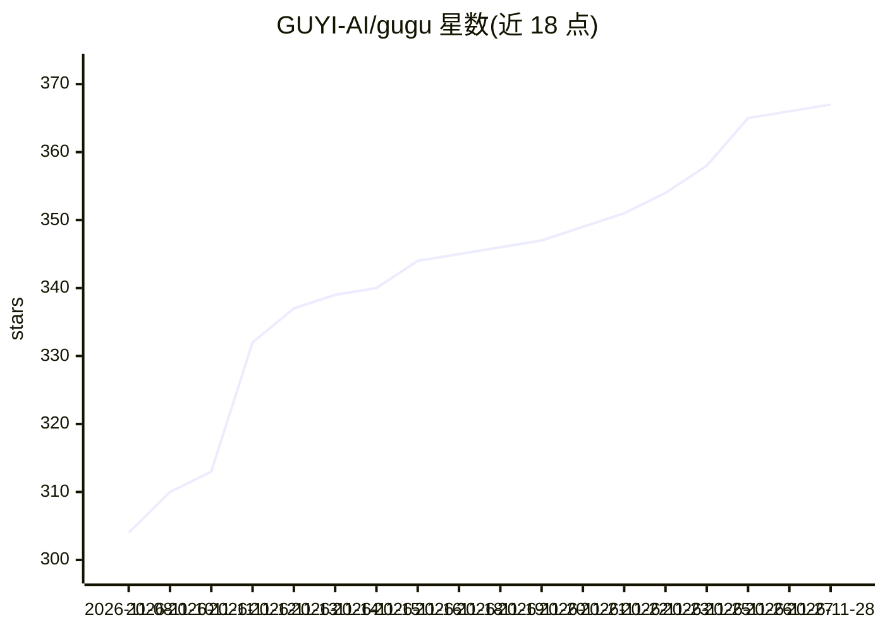

# GUYI-AI/gugu

⭐ 367 · TypeScript · NOASSERTION · 推送 2026-11-27 · [GitHub](https://github.com/GUYI-AI/gugu) · [官网](https://gugu.nextmind.space) · 组织维护 · 中文 README

**连接 agent 与团队成员的桌面/Android 协作客户端**

gugu 是一个桌面与 Android 客户端，用户在自己机器上运行 Claude Code、Codex 等 agent，并在共享群组、文件与应用中与 agent 和其他人协作。功能包括分屏工作区（聊天/文件/应用并排）、每群组一个文件夹的文件协同编辑、个人助理（记忆、提醒、日程）、按任务选择引擎与模型（官方模型、API key 或自有 Claude Code/Codex 登录）、lead agent 拆分子 agent 的项目树、应用市场（Context、Data Lens、Gugu Office、Arcade）、MCP 服务器库，以及通过 SSH/远程隧道把 agent 添加到其他机器。提供 macOS/Windows/Linux/Android 下载与自托管仓库。

## 筛选速览

| 维度 | 判定 | 备注 |
|---|---|---|
| AI 角色 | `ai-ecosystem` | LLM/agent 周边工具 |
| 许可风险 | `none` | NOASSERTION |
| 部署形态 | `None` |  |
| 模型依赖 | — | README 未给出锁定关系 |
| 硬件要求 | — | 无带数字的原话,不猜 |
| 安装摩擦 | `low` | 无编译、无系统依赖或容器化 |
| 成熟度 | — | 结构信号不足 |

## 能力要点

- 群组内共享上下文与文件，agent 编辑实时写入打开的文档
- lead agent 生成按职责命名的子 agent，项目树展示分工
- 按任务选择引擎与模型：官方模型、API key 或自有 Claude Code/Codex 登录
- MCP 服务器库与开源应用市场（应用自带工具与 Skills）

## 适用场景

- 与同事在群组中共享 agent 与文件协作完成任务
- 用个人助理记录请求并设置提醒和日程
- 通过应用市场安装 Calendar/Data Lens 等应用扩展聊天场景
- 把 agent 部署到服务器或远程机器上运行任务

## 场景标签

`编码 Agent` `AI 助手` · 领域:编码与开发

## 证据(README 行号)

> L15: gugu is a desktop and Android client. You run Claude Code, Codex and other agents on your own machines, and work wi
> L35:  </a> Pick an engine and a model for each task: gugu's models, an API key, or your own Claude Code and Codex sign-i

## 星数曲线

2026-11-08 304 → 2026-11-28 367（+63）

---
*卡片 v1 · prompt 1.4 · 生成 2026-11-25 · 置信度 high · 依据 README sha `c1588d3fe555` · [字段定义](../../DATASET.md)*
