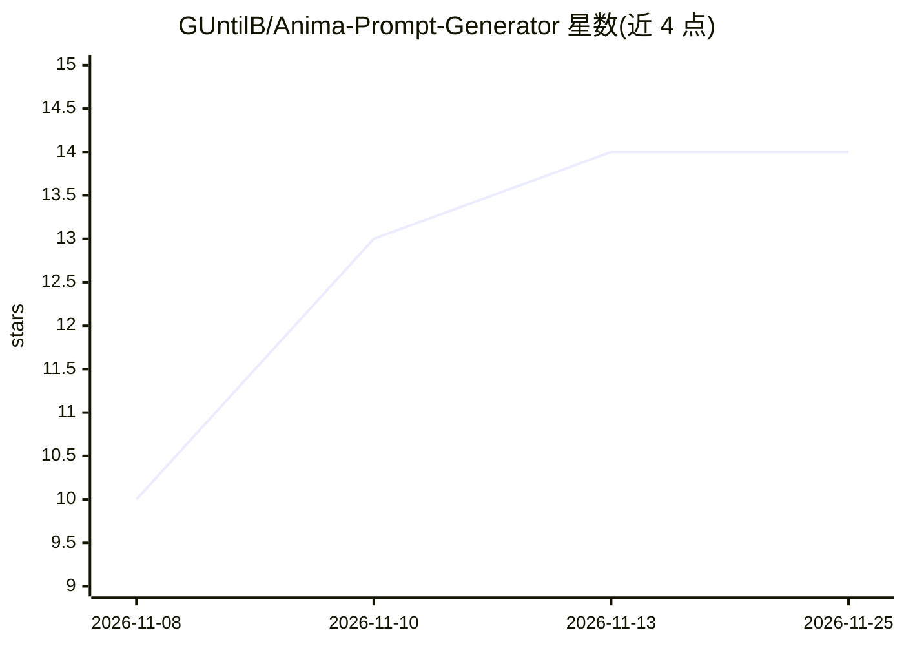

# GUntilB/Anima-Prompt-Generator

⭐ 14 · Python · GPL-3.0 · 推送 2026-11-08 · [GitHub](https://github.com/GUntilB/Anima-Prompt-Generator) · [官网](https://registry.comfy.org/nodes/anima-prompt-generator) · 个人维护

**给 ComfyUI 用户把简短创意转成经校验的 Anima Danbooru 标签提示词**

一套 ComfyUI 自定义节点，包含两个部分：LM Studio 节点把任意语言的短句发给本地 LLM，生成 character/action/description 等分行内容；Prompt Builder 节点对照约 33,800 条 Danbooru 标签与约 7,500 条别名字典校验每个标签，修正名称顺序、连字符与近似标签，按固定分组顺序拼装提示词并输出修改报告。支持 sfw/nsfw/custom 三种提示词配置、LLM 结果缓存、按需加载并在回答后卸载模型以释放显存。安装方式为放入 ComfyUI custom_nodes 目录或经 ComfyUI Registry；需运行 LM Studio 本地服务器，无额外 Python 依赖。

## 筛选速览

| 维度 | 判定 | 备注 |
|---|---|---|
| AI 角色 | `ai-native` | 本体是模型或模型工具 |
| 许可风险 | `viral` | GPL-3.0 |
| 部署形态 | `None` |  |
| 模型依赖 | local-ok | 支持本地模型 |
| 硬件要求 | — | 无带数字的原话,不猜 |
| 安装摩擦 | `low` | 无编译、无系统依赖或容器化 |
| 成熟度 | — | 结构信号不足 |

## 能力要点

- 对照约 33,800 Danbooru 标签与 7,500 别名字典逐标签校验并自动修正
- LLM 回答缓存与按需加载/卸载模型以释放显存
- sfw / nsfw / custom 三种提示词配置，系统提示词文件可即时编辑
- 支持俄语界面与文档，status/report 输出跟随 ComfyUI 界面语言

## 适用场景

- 在 ComfyUI 中为 Anima 文生图工作流快速生成规范提示词
- 自动修正 LLM 写错的标签顺序、别名与角色发色等常见问题
- 在显存有限的显卡上切换加载 LLM 与图像模型

## 场景标签

`提示工程` · 领域:Agent 开发

## 证据(README 行号)

> L5: Write a short idea in any language. A local LLM turns it into Danbooru tags and a short description, and a builder c
> L19: 1. **Anima LM Studio (prompt LLM)** sends your idea and a system prompt to a local LM Studio server and gets back l
> L74: - ComfyUI with the Anima model files (see the note inside the example workflow).

## 星数曲线

2026-11-08 10 → 2026-11-25 14（+4）

---
*卡片 v1 · prompt 1.4 · 生成 2026-11-18 · 置信度 high · 依据 README sha `9f2968b294fc` · [字段定义](../../DATASET.md)*
