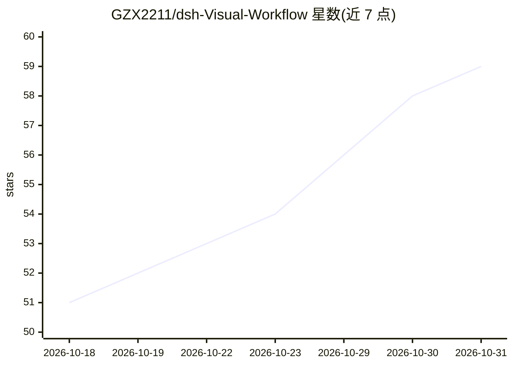

# GZX2211/dsh-Visual-Workflow

⭐ 59 · TypeScript · MIT · 推送 2026-10-29 · [GitHub](https://github.com/GZX2211/dsh-Visual-Workflow) · 个人维护 · 中文 README

**DeepSeek Harness 的可视化 Agent 编排插件平台**

基于 DeepSeek Harness（要求 0.2.1-rc.2）的可视化 Agent 编排插件，在同一工作台中组合固定 Workflow、Agent Team、元编排、人类在环与组织记忆。提供角色/任务/数据库/阶段/团队五类节点画布，父代理通过 wf_run_node 等插件工具自主推进流程；支持断点续跑、定时触发、一键发布 OpenAI 兼容 REST API，本地 SQLite 内置向量检索（bge-small-zh-v1.5，失败降级 BM25），也支持 MySQL/PostgreSQL。通过 dsh plugin 命令或桌面端插件页安装，数据存储于 ~/.dsh/ 目录。

## 筛选速览

| 维度 | 判定 | 备注 |
|---|---|---|
| AI 角色 | `ai-ecosystem` | LLM/agent 周边工具 |
| 许可风险 | `permissive` | MIT |
| 部署形态 | `library` | 以包/库形式分发 |
| 模型依赖 | locked-api |  |
| 硬件要求 | — | 无带数字的原话,不猜 |
| 安装摩擦 | `low` | 无编译、无系统依赖或容器化 |
| 成熟度 | — | 结构信号不足 |

## 能力要点

- 画布式节点编排：角色/任务/数据库/阶段/团队五类节点与三类连线
- Agent 元编排：根据组织资产与经验生成、调整组织结构
- 双模式：流程编排模式与 OpenAI 兼容 REST API 服务模式（多租户会话隔离）
- 本地 SQLite 向量检索（bge-small-zh-v1.5，失败降级 BM25）

## 适用场景

- 在可视化画布上设计多 Agent 工作流并实时人工干预
- 把编排好的工作流发布为 OpenAI 兼容 API 服务
- 通过定时任务自动运行工作流并错峰调用 API
- 将 DSH 部署为独立后端连接 QQ 机器人、飞书等外部应用

## 场景标签

`多智能体` `工作流自动化` · 领域:Agent 开发

## 证据(README 行号)

> L3:  基于 DeepSeek Harness 打造的可视化 Agent 编排平台
> L199: dsh plugin --profile web add "github:GZX2211/dsh-Visual-Workflow#main"

## 星数曲线

2026-10-18 51 → 2026-10-31 59（+8）

---
*卡片 v1 · prompt 1.4 · 生成 2026-10-24 · 置信度 mid · 依据 README sha `259f3226d6de` · [字段定义](../../DATASET.md)*
