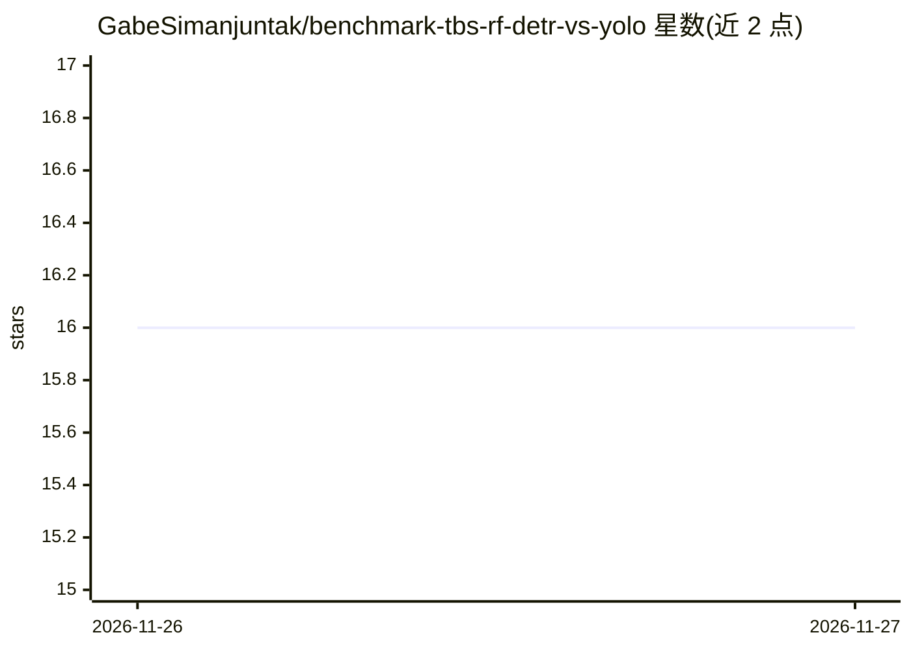

# GabeSimanjuntak/benchmark-tbs-rf-detr-vs-yolo

⭐ 16 · Jupyter Notebook · 推送 2026-11-25 · [GitHub](https://github.com/GabeSimanjuntak/benchmark-tbs-rf-detr-vs-yolo) · 个人维护

**油棕果成熟度检测跨域基准：RF-DETR 与 YOLO 对比研究**

一项比较 RF-DETR、YOLO11 与 YOLOv8 在油棕新鲜果束（TBS/FFB）成熟度检测中跨域泛化能力的研究项目。使用印尼与马来西亚工厂、种植园环境的三个公开数据集，统一三类数据集的类别分类体系，在跨数据集场景下测试模型，以 mAP@0.5、mAP@0.5:0.95 与 FPS 评估精度与推理速度。仓库按 datasets/notebooks/src/configs/results/docs 组织，当前处于初始准备与数据收集阶段，基于 Python、Google Colab 与 PyTorch 开展。

## 筛选速览

| 维度 | 判定 | 备注 |
|---|---|---|
| AI 角色 | `ai-native` | 本体是模型或模型工具 |
| 许可风险 | `none` | — |
| 部署形态 | `None` |  |
| 模型依赖 | — | README 未给出锁定关系 |
| 硬件要求 | — | 无带数字的原话,不猜 |
| 安装摩擦 | `low` | 无编译、无系统依赖或容器化 |
| 成熟度 | `idea` | |

## 能力要点

- 比较 RF-DETR、YOLO11、YOLOv8 三个检测模型
- 使用工厂与种植园两类环境的三个公开数据集做跨域测试
- 评估指标覆盖 mAP@0.5、mAP@0.5:0.95 与 FPS
- 统一对齐三个数据集的类别分类体系

## 适用场景

- 研究检测模型在工厂与种植园不同域间的泛化表现
- 参考油棕果成熟度检测数据集与实验配置
- 复现检测模型的精度与推理速度对比实验

## 场景标签

`模型评测` `目标检测` · 领域:评测与运维

## 证据(README 行号)

> L5: Penelitian ini bertujuan untuk membandingkan kemampuan model object detection RF-DETR, YOLO11, dan YOLOv8 dalam mend
> L45: - Python
> L52: Currently in the initial preparation and dataset collection stage.

## 星数曲线

2026-11-26 16 → 2026-11-27 16（+0）

---
*卡片 v1 · prompt 1.4 · 生成 2026-11-26 · 置信度 high · 依据 README sha `dcb02054c0ad` · [字段定义](../../DATASET.md)*
