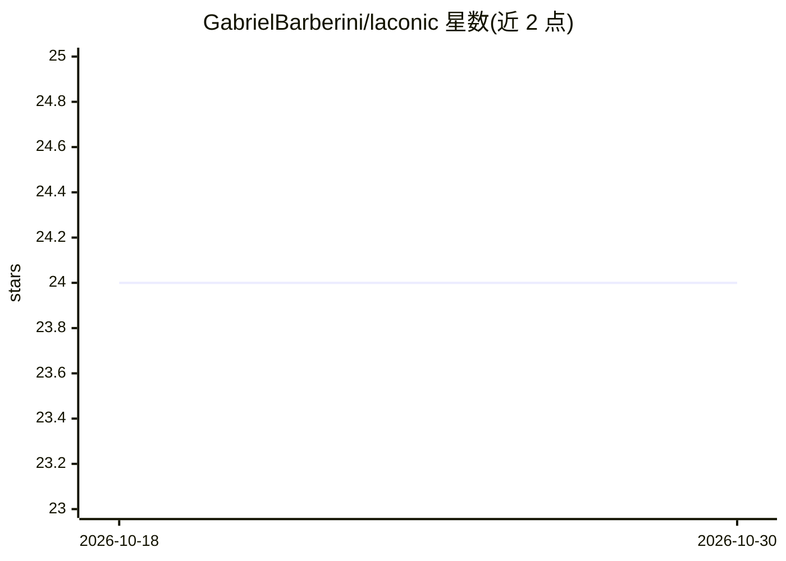

# GabrielBarberini/laconic

⭐ 24 · Python · MIT · 推送 2026-07-12 · [GitHub](https://github.com/GabrielBarberini/laconic) · 个人维护

**让 AI 编程代理精简输出的 300 词技能**

一个约 300 词的 SKILL.md 格式技能，改编自 caveman，用于让 AI 编程代理以最少的 token 回答：删减填充词、省略读者已知内容、只给恰好够用的代码。README 给出基准测试（Claude Sonnet 4，平均节省约 90% 输出 token，仅压缩输出不压缩输入），以及示例对比。支持通过 npx skills、Claude Code 插件市场、Codex 插件、pi 等途径安装到 40+ 代理。

## 筛选速览

| 维度 | 判定 | 备注 |
|---|---|---|
| AI 角色 | `ai-ecosystem` | LLM/agent 周边工具 |
| 许可风险 | `permissive` | MIT |
| 部署形态 | `library` | 以包/库形式分发 |
| 模型依赖 | — | README 未给出锁定关系 |
| 硬件要求 | — | 无带数字的原话,不猜 |
| 安装摩擦 | `low` | 无编译、无系统依赖或容器化 |
| 成熟度 | — | 结构信号不足 |

## 能力要点

- 约 300 词的技能文件，改编自 caveman 风格
- 基准显示平均节省约 90% 输出 token（仅压缩输出）
- 通过 npx skills 支持 Claude Code、Copilot、Cursor 等 40+ 代理
- pi 环境额外提供 /laconic 开关、状态栏与自然语言触发

## 适用场景

- 让我的编程代理回答更简短省 token
- 在 Cursor/Copilot/Claude Code 中切换精简输出模式
- 降低高频调用下的输出 token 成本

## 场景标签

`提示工程` · 领域:Agent 开发

## 证据(README 行号)

> L15: **laconic** is a 300 word skill for AI coding agents inspired by caveman.
> L89: `npx skills` supports Claude Code, GitHub Copilot, Cursor, Windsurf, Cline, and 40+ more. To install for a specific

## 星数曲线

2026-10-18 24 → 2026-10-30 24（+0）

---
*卡片 v1 · prompt 1.4 · 生成 2026-10-27 · 置信度 mid · 依据 README sha `303a3f42b94e` · [字段定义](../../DATASET.md)*
