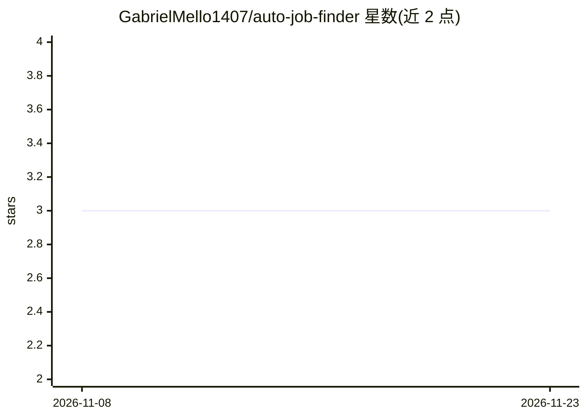

# GabrielMello1407/auto-job-finder

⭐ 3 · TypeScript · MIT · 推送 2026-11-18 · [GitHub](https://github.com/GabrielMello1407/auto-job-finder) · 个人维护

**求职申请 AI 代理：找职位并生成简历与投递材料**

面向求职者的本地 CLI/Web 应用：从简历、LinkedIn PDF、作品集等来源构建个人档案，在职位板、Gupy、Google for Jobs 及网络搜索职位并按匹配度打分，为每个职位生成 ATS 简历、求职信、投递邮件、表单填写内容与跟进消息，并跟踪申请进度与回复率。依赖用户已有的 Claude/ChatGPT/Gemini 订阅或 API key。内置代码级防编造守卫，阻断无来源数字与虚构经历；数据仅存本地。界面支持英/巴西葡萄牙语。

## 筛选速览

| 维度 | 判定 | 备注 |
|---|---|---|
| AI 角色 | `ai-native` | 本体是模型或模型工具 |
| 许可风险 | `permissive` | MIT |
| 部署形态 | `library` | 以包/库形式分发 |
| 模型依赖 | local-ok | 支持本地模型 |
| 硬件要求 | — | 无带数字的原话,不猜 |
| 安装摩擦 | `low` | 无编译、无系统依赖或容器化 |
| 成熟度 | — | 结构信号不足 |

## 能力要点

- 聚合多种职位来源并按匹配度、空缺与骗局信号打分排序
- 为每个职位生成整套投递材料（简历/求职信/邮件/表单答案）
- 代码级防编造守卫：无来源的数字与虚构经历被拦截
- 支持订阅账号（无需 API key）或 Anthropic/OpenAI 等多种 API

## 适用场景

- 每天自动搜索并筛选匹配我背景的职位
- 为每个目标职位生成定制化 ATS 简历和求职信
- 跟踪投递结果，分析哪个渠道和简历版本回复率更高
- 让 AI 审查并优化我的 LinkedIn 资料

## 场景标签

`AI 写作` · 领域:内容生成

## 证据(README 行号)

> L3:  Your job-application agent, for any field and any job.
> L22: 1. **Builds your profile** from whatever you have: a resume (PDF or DOCX), your LinkedIn PDF, a portfolio, GitHub, 
> L37: It works with the AI you **already have**: a **Claude**, **ChatGPT** (Codex) or **Google** (Gemini) subscription, n

## 星数曲线

2026-11-08 3 → 2026-11-23 3（+0）

---
*卡片 v1 · prompt 1.4 · 生成 2026-11-22 · 置信度 high · 依据 README sha `42b059fde631` · [字段定义](../../DATASET.md)*
