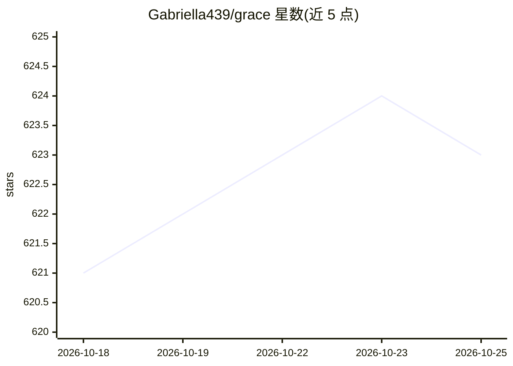

# Gabriella439/grace

⭐ 623 · Haskell · BSD-3-Clause · 推送 2026-08-31 · [GitHub](https://github.com/Gabriella439/grace) · [官网](https://trygrace.dev/) · 个人维护

**面向提示工程的函数式 DSL，构建与生成提示链**

Grace（Fall-from-Grace）是一门用于提示模型的领域专用函数式编程语言，适合构建与自动生成提示链。语言内置 prompt 函数，可通过类型标注或从使用处反向推断生成 JSON schema 以约束模型输出，支持省略提示文本甚至类型；import prompt 可让模型生成符合指定类型的 Grace 代码（含嵌套 prompt 的代码）。以 Haskell 包形式构建 grace 命令行工具，提供 interpret 与 repl 子命令；也可通过 trygrace.dev 在浏览器中免安装使用。

## 筛选速览

| 维度 | 判定 | 备注 |
|---|---|---|
| AI 角色 | `ai-ecosystem` | LLM/agent 周边工具 |
| 许可风险 | `permissive` | BSD-3-Clause |
| 部署形态 | `None` |  |
| 模型依赖 | — | README 未给出锁定关系 |
| 硬件要求 | — | 无带数字的原话,不猜 |
| 安装摩擦 | `low` | 无编译、无系统依赖或容器化 |
| 成熟度 | — | 结构信号不足 |

## 能力要点

- 内置 prompt 函数，无需安装依赖或导入
- 类型检查器从使用处反向推断 JSON schema 约束模型输出
- import prompt 生成符合类型签名的 Grace 代码
- 提供 grace interpret / repl 命令行工具与浏览器在线环境

## 适用场景

- 以编程语言方式构建结构化的模型提示链
- 让模型按推断的类型生成 JSON 或代码输出
- 在浏览器中交互式学习与试验提示程序

## 场景标签

`提示工程` · 领域:Agent 开发

## 证据(README 行号)

> L6: Grace (short for Fall-from-Grace) is a domain-specific programming
> L7: language for prompting models. In particular, Grace is well-suited for building

## 星数曲线

2026-10-18 621 → 2026-10-25 623（+2）

---
*卡片 v1 · prompt 1.4 · 生成 2026-10-21 · 置信度 high · 依据 README sha `4a736984dbad` · [字段定义](../../DATASET.md)*
