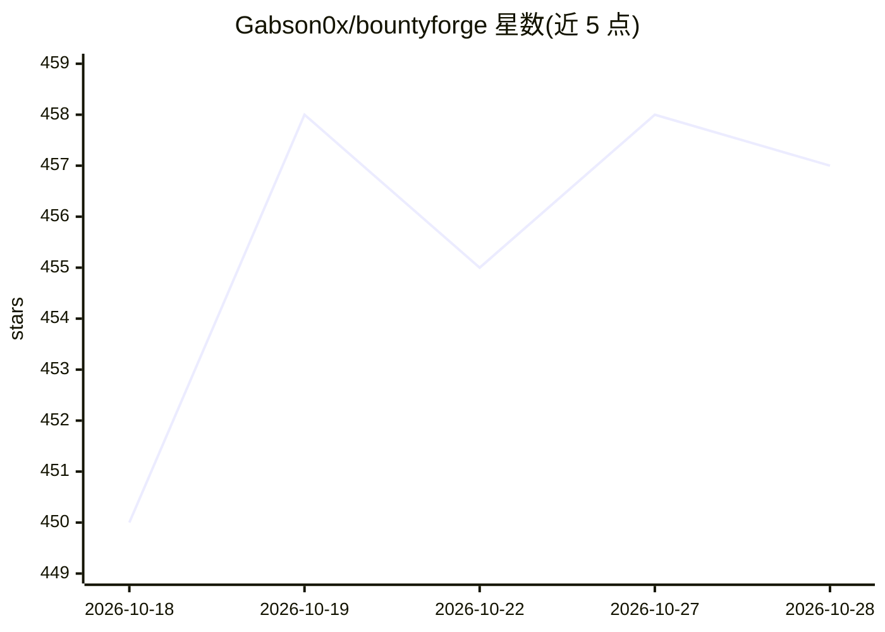

# Gabson0x/bountyforge

⭐ 457 · Python · 推送 2026-09-16 · [GitHub](https://github.com/Gabson0x/bountyforge) · [官网](https://bountyforge.xyz) · 个人维护

**Claude Code 渗透测试技能：8 并行安全代理产出赏金平台报告**

面向安全研究员与赏金猎人的 Claude Code 技能（SKILL.md 形式）：对 web/API、智能合约（EVM/Move/Solana/TRON）等目标并行运行 8 个专职安全代理，发现经四道验证门（驳斥/可达/触发/影响）过滤、CVSS 打分并去重，生成 HackerOne/Bugcrowd/Intigriti/Immunefi 格式报告。开启本地执行后可编排 nmap、ffuf、sqlmap 等 CLI 工具；另提供 bountyforge.xyz 云端微虚拟机沙箱与可选的 Bug Bounty Intelligence MCP。仅限授权测试。

## 筛选速览

| 维度 | 判定 | 备注 |
|---|---|---|
| AI 角色 | `ai-native` | 本体是模型或模型工具 |
| 许可风险 | `none` | — |
| 部署形态 | `library` | 以包/库形式分发 |
| 模型依赖 | locked-api |  |
| 硬件要求 | — | 无带数字的原话,不猜 |
| 安装摩擦 | `low` | 无编译、无系统依赖或容器化 |
| 成熟度 | — | 结构信号不足 |

## 能力要点

- 8 个并行专职安全代理，覆盖 web/API、智能合约、业务逻辑、经济安全等面
- 四道验证门（Refutation/Reachability/Trigger/Impact）过滤发现并 CVSS 打分
- 可编排本地 CLI 工具（nmap/ffuf/amass/sqlmap/gobuster/zap 等）
- 输出 HackerOne/Bugcrowd/Intigriti/Immunefi 四平台格式报告

## 适用场景

- 对智能合约或 API 目标做自动化安全审计并产出提交就绪报告
- 编排本地扫描工具执行侦察到报告的完整流程
- 按平台模板快速生成漏洞赏金提交报告

## 场景标签

`网络安全` `多智能体` · 领域:Agent 开发

## 证据(README 行号)

> L11: Bounty Forge spins up **8 specialized security agents in parallel**, each attacking a different surface of your tar
> L26: **Local tooling:** When Claude Code execution is enabled, BountyForge can orchestrate local CLI tools like `nmap`, 
> L212: Every finding passes four gates before it's confirmed:

## 星数曲线

2026-10-18 450 → 2026-10-28 457（+7）

---
*卡片 v1 · prompt 1.4 · 生成 2026-10-21 · 置信度 mid · 依据 README sha `7d4774d68438` · [字段定义](../../DATASET.md)*
