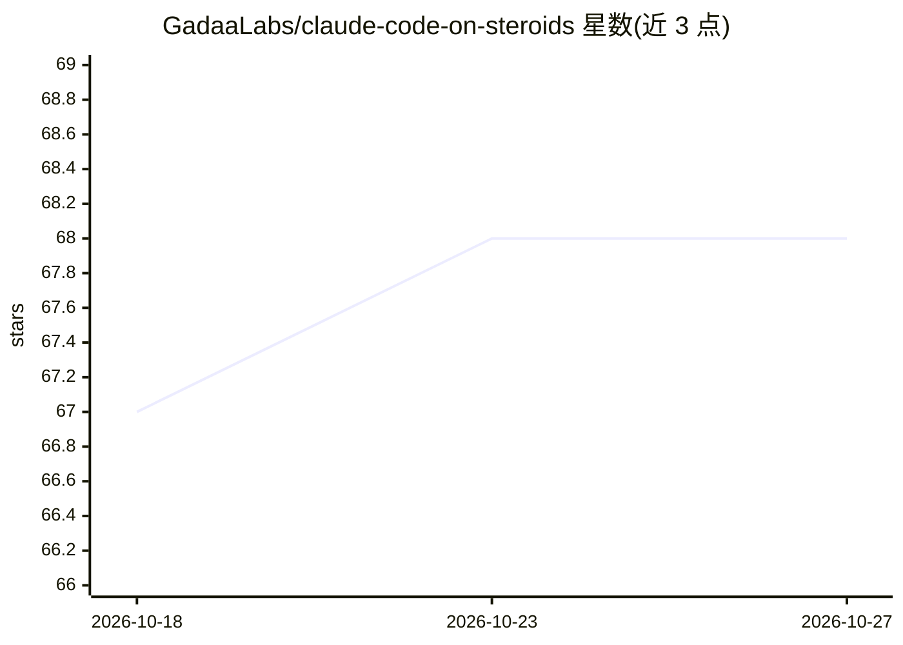

# GadaaLabs/claude-code-on-steroids

⭐ 68 · Shell · 推送 2026-04-29 · [GitHub](https://github.com/GadaaLabs/claude-code-on-steroids) · [官网](https://gadaalabs.com/courses/claude-code-superpowers) · 组织维护

**Claude Code 技能扩展包：24 技能+覆盖基础设施+token 分析**

基于 obra/superpowers 扩展的 Claude Code 技能系统：从 14 个技能扩展到 24 个（含 oracle 任务分流、chronicle 自学习记忆、vector 成本路由、horizon 上下文管理等 10 个新技能），并加入插件更新后仍可保留自定义修改的 override 基础设施（SessionStart 钩子 + apply.sh 复制 9 个固定技能文件）。内置 /tokenburn CLI，读取本地 ~/.claude 会话 JSONL 日志生成成本看板，无外部上报。一条 curl 命令安装，需 Claude Code CLI 与 Node.js 20+。面向使用 Claude Code 的开发者。

## 筛选速览

| 维度 | 判定 | 备注 |
|---|---|---|
| AI 角色 | `ai-ecosystem` | LLM/agent 周边工具 |
| 许可风险 | `none` | — |
| 部署形态 | `library` | 以包/库形式分发 |
| 模型依赖 | — | README 未给出锁定关系 |
| 硬件要求 | — | 无带数字的原话,不猜 |
| 安装摩擦 | `low` | 无编译、无系统依赖或容器化 |
| 成熟度 | — | 结构信号不足 |

## 能力要点

- 在 obra/superpowers 基础上扩展至 24 个技能（新增 10 个）
- SessionStart 钩子 + apply.sh 使 9 个固定技能在插件更新后保留
- /tokenburn 读取本地 JSONL 会话日志生成 token/成本分析看板
- Karpathy 四原则作为 CLAUDE.md 常驻行为层

## 适用场景

- 为 Claude Code 补充结构化工作流与领域技能
- 查看各项目/模型的 token 花费分布
- 保留对 superpowers 插件的自定义修改不被更新覆盖

## 场景标签

`提示工程` `LLM 可观测性` · 领域:Agent 开发

## 证据(README 行号)

> L5: Built on obra/superpowers by Jesse Vincent. Extended with 10 new skills, specific engineering improvements directed 
> L11: **Requires:** Claude Code CLI · Node.js 20+

## 星数曲线

2026-10-18 67 → 2026-10-27 68（+1）

---
*卡片 v1 · prompt 1.4 · 生成 2026-10-24 · 置信度 high · 依据 README sha `a4903f28dc5f` · [字段定义](../../DATASET.md)*
