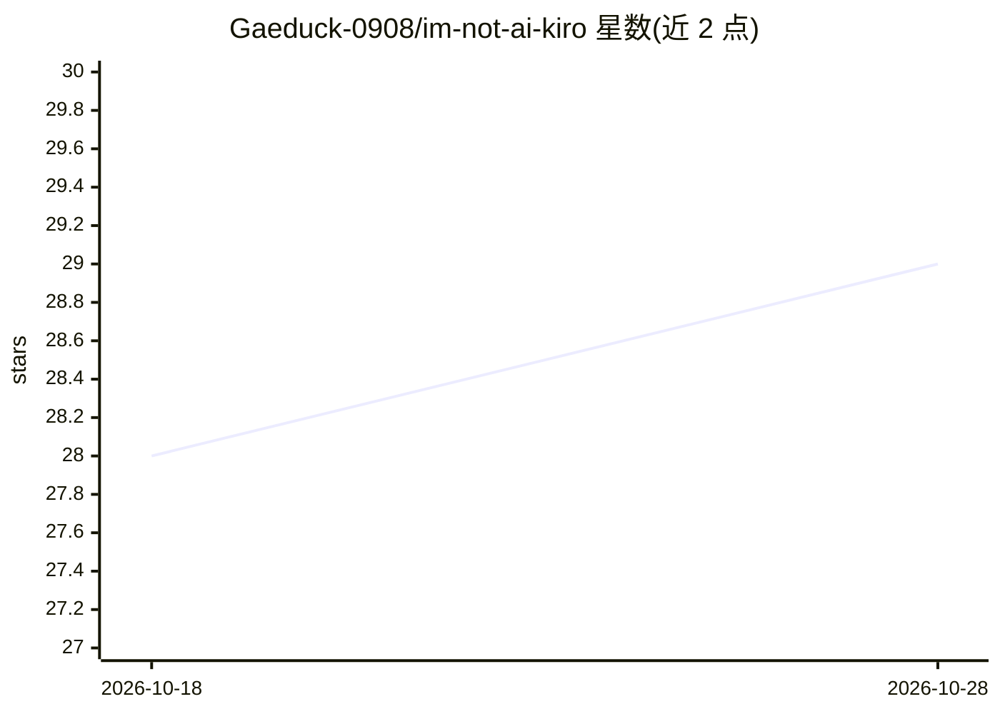

# Gaeduck-0908/im-not-ai-kiro

⭐ 28 · Python · MIT · 推送 2026-09-14 · [GitHub](https://github.com/Gaeduck-0908/im-not-ai-kiro) · 个人维护

**去除韩文 AI 文本痕迹的 Kiro CLI 代理（4 代理）**

epoko77-ai/im-not-ai 的社区移植版，将原项目的分类体系、润色处方、验证代码与代理设计转换为 Kiro CLI 使用：提供编排代理与 3 个执行角色共 4 个代理，通过 `kiro-cli chat --agent humanize-korean` 修饰 AI 生成的韩文文本中的翻译腔、俗套表达与机械句式，同时保留事实、数值、引用、核心概念与原文格式。处理分 light/standard/heavy 三条路径，含代码验证；变更率 30% 以上警告、50% 以上中止采纳。需 Kiro CLI 3.0+ 与 Python 3.10+，无额外 Python 依赖，结果保存至用户工作目录。

## 筛选速览

| 维度 | 判定 | 备注 |
|---|---|---|
| AI 角色 | `ai-native` | 本体是模型或模型工具 |
| 许可风险 | `permissive` | MIT |
| 部署形态 | `None` |  |
| 模型依赖 | — | README 未给出锁定关系 |
| 硬件要求 | — | 无带数字的原话,不猜 |
| 安装摩擦 | `low` | 无编译、无系统依赖或容器化 |
| 成熟度 | — | 结构信号不足 |

## 能力要点

- light/standard/heavy 三条处理路径，按输入分析自动路由
- 变更率阈值控制：30% 以上警告、50% 以上中止采纳
- 检查数值、引用、脚注、标题、格式与语体损失
- 提供离线单元测试与规则构建校验脚本（Linux/macOS/Windows CI）

## 适用场景

- 润色 AI 生成的韩文初稿以减少翻译腔与机械句式
- 按不同体裁（专栏/报告/博客/公文/学术）定制润色强度
- 在语义保留验证下对长文进行分块精修

## 场景标签

`AI 写作` · 领域:内容生成

## 证据(README 行号)

> L3: AI가 쓴 한글 글의 번역투·상투구·기계적인 문장 구조를 다듬는 Kiro CLI 에이전트입니다. 사실·수치·인용·핵심 개념과 원문의 격식은 보존합니다.
> L54: kiro-cli chat --agent humanize-korean
> L76: |경로|기본 흐름|용도|

## 星数曲线

2026-10-18 28 → 2026-10-28 29（+1）

---
*卡片 v1 · prompt 1.4 · 生成 2026-10-26 · 置信度 high · 依据 README sha `f6b3c343ccd0` · [字段定义](../../DATASET.md)*
