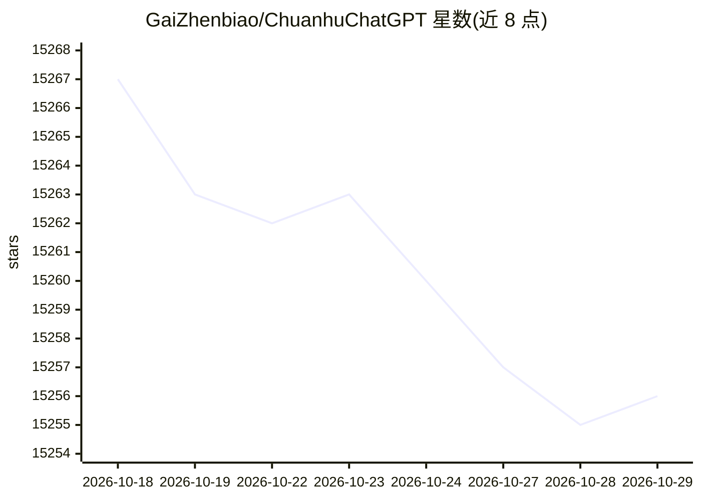

# GaiZhenbiao/ChuanhuChatGPT

⭐ 15,256 · Python · GPL-3.0 · 推送 2026-09-16 · [GitHub](https://github.com/GaiZhenbiao/ChuanhuChatGPT) · [官网](https://huggingface.co/spaces/JohnSmith9982/ChuanhuChatGPT) · 个人维护 · 中文 README

**为多种 LLM 提供带附加功能的 Web 聊天界面**

基于 Gradio 的 Web 图形界面，为 ChatGPT 等多种 LLM 提供对话入口。支持 API 调用模型（ChatGPT、Azure OpenAI、Gemini、Claude、DeepSeek 等）与本地部署模型（ChatGLM、LLaMA、Qwen 等），并提供川虎助理（类 AutoGPT 全自动代理）、在线搜索、基于文件问答的知识库、GPT-3.5 微调、Prompt 模板、对话历史管理与多 api-key 负载均衡等功能。通过 git clone 加 pip 安装依赖后以 Python 启动，可部署到服务器或 Hugging Face Space，也支持作为 PWA 安装。

## 筛选速览

| 维度 | 判定 | 备注 |
|---|---|---|
| AI 角色 | `ai-ecosystem` | LLM/agent 周边工具 |
| 许可风险 | `viral` | GPL-3.0 |
| 部署形态 | `library` | 以包/库形式分发 |
| 模型依赖 | local-ok | 支持本地模型 |
| 硬件要求 | — | 无带数字的原话,不猜 |
| 安装摩擦 | `low` | 无编译、无系统依赖或容器化 |
| 成熟度 | — | 结构信号不足 |

## 动量与使用信号

- 维护:`active` — 距上次 push 31.9 天,年发版 0,54 位贡献者
- 涨星:近 1 天 **+0**(自 20261016 起算)
- 下载:GitHub Release 附件 累计 4,064(27 个 release)
- 平台:WINDOWS / MACOS / LINUX / ANDROID / IOS · 协议:—

## 能力要点

- 接入多种 API 模型与本地部署模型（含 Lora 支持）
- 川虎助理、在线搜索、文件问答知识库、GPT-3.5 微调
- 支持 PWA 安装与移动端适配，多用户历史记录隔离
- 支持自定义 api-host、代理与多 api-key 负载均衡

## 适用场景

- 在统一界面里使用 ChatGPT、Gemini、Claude 等多家模型对话
- 基于自己的文档向大模型提问
- 一键在本地部署开源大语言模型进行对话
- 对 GPT-3.5 做微调以获得个性化回答

## 场景标签

`聊天机器人` `文档问答` `微调` · 领域:对话与助手

## 证据(README 行号)

> L9:  为ChatGPT等多种LLM提供了一个轻快好用的Web图形界面和众多附加功能
> L57: |API 调用模型|备注|本地部署模型|备注|
> L125: git clone https://github.com/GaiZhenbiao/ChuanhuChatGPT.git

## 星数曲线

2026-10-18 15,267 → 2026-10-29 15,256（-11）

---
*卡片 v1 · prompt 1.4 · 生成 2026-10-18 · 置信度 high · 依据 README sha `0eefabe5443a` · [字段定义](../../DATASET.md)*
