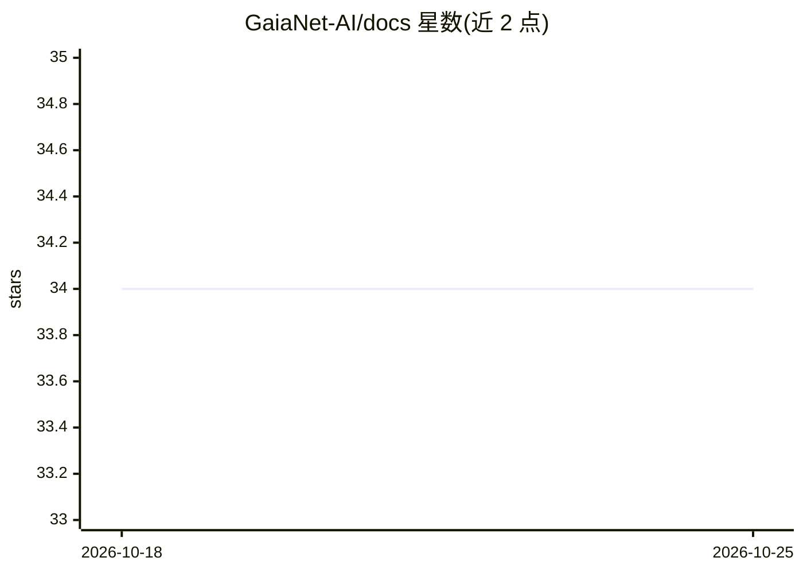

# GaiaNet-AI/docs

⭐ 34 · HTML · Apache-2.0 · 推送 2025-11-06 · [GitHub](https://github.com/GaiaNet-AI/docs) · [官网](https://docs.gaianet.ai) · 组织维护

**Gaia 去中心化 AI 基础设施的官方文档站**

GaiaNet 维护的官方文档项目，基于 Docusaurus 构建：内容覆盖节点运行、节点部署到 domains、框架集成，以及用去中心化推理构建和运行 AI agent 的指南，面向 Gaia 节点运营商、用户与创作者。本地运行需 fork 后 git clone，npm install 安装依赖，npm start 启动开发服务器（localhost:3000），合并到主分支后自动部署至 docs.gaianet.ai。项目接受社区贡献，采用 Apache 2.0 许可证。

## 筛选速览

| 维度 | 判定 | 备注 |
|---|---|---|
| AI 角色 | `ai-knowledge` | 知识聚合/清单类 |
| 许可风险 | `permissive` | Apache-2.0 |
| 部署形态 | `library` | 以包/库形式分发 |
| 模型依赖 | — | README 未给出锁定关系 |
| 硬件要求 | — | 无带数字的原话,不猜 |
| 安装摩擦 | `low` | 无编译、无系统依赖或容器化 |
| 成熟度 | — | 结构信号不足 |

## 能力要点

- 覆盖节点运行、domains 部署与去中心化推理 agent 构建的文档
- Docusaurus 构建，npm 本地运行开发服务器
- 合并主分支后自动部署到 docs.gaianet.ai

## 适用场景

- 查阅 Gaia 节点的运行与部署指南
- 查找 Gaia 与各框架的集成方法
- 通过 issue/PR/翻译参与文档共建

## 场景标签

 · 领域:去中心化 AI 基础设施/文档

## 证据(README 行号)

> L3: Gaia is a decentralized AI infrastructure that empowers everyone to build, scale, and monetize personalized AI agent
> L35: - `docs/`: Contains all the markdown files for the documentation

## 星数曲线

2026-10-18 34 → 2026-10-25 34（+0）

---
*卡片 v1 · prompt 1.4 · 生成 2026-10-25 · 置信度 high · 依据 README sha `98846a354075` · [字段定义](../../DATASET.md)*
