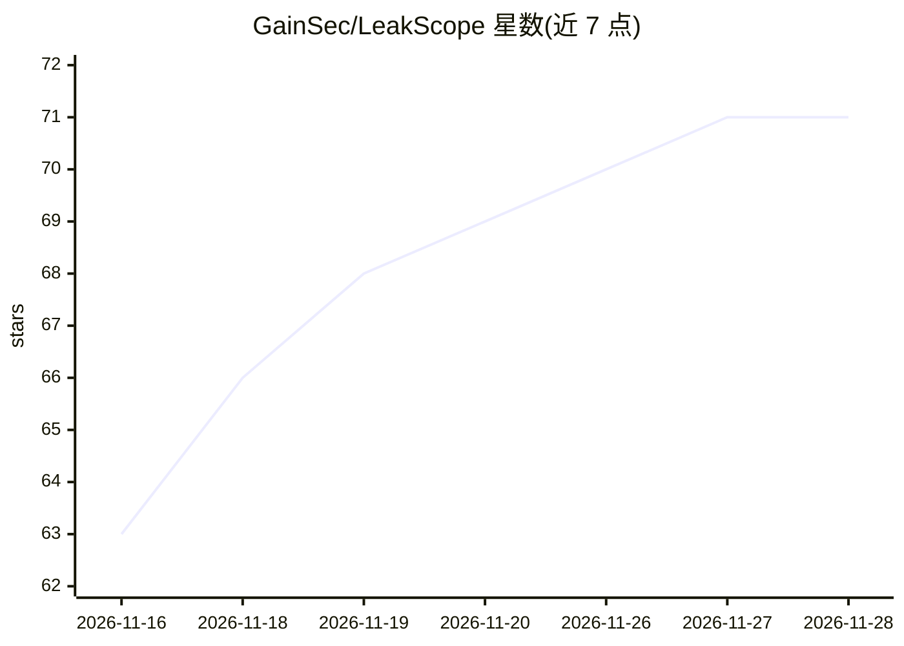

# GainSec/LeakScope

⭐ 71 · Python · NOASSERTION · 推送 2026-11-16 · [GitHub](https://github.com/GainSec/LeakScope) · [官网](https://gainsec.com) · 组织维护

**自托管外部暴露面发现与监控平台，聚合 20+ 服务取证**

面向安全测试与暴露管理的自托管 Web 应用：通过 Shodan/ZoomEye/Netlas 等供应商 API、搜索 dorking、证书透明度流与直接服务检查，发现资产、收集证据并监控变化。功能覆盖云端资源发现、域名扩展、组织资产分组、证据截图与协议转录、定时任务和无代码工作流。支持 ICS/OT 协议的只读查询。AI 仅为可选配置（LLM_API_BASE 等设置项提供 Ask 与 Research 的查询建议），本体不依赖 AI。以 Docker Compose 部署，需至少一个供应商 API key。

## 筛选速览

| 维度 | 判定 | 备注 |
|---|---|---|
| AI 角色 | `ai-enhanced` | 去掉 AI 部分产品仍成立 |
| 许可风险 | `none` | NOASSERTION |
| 部署形态 | `self-host` | docker 或自建部署 |
| 模型依赖 | — | README 未给出锁定关系 |
| 硬件要求 | — | 无带数字的原话,不猜 |
| 安装摩擦 | `low` | 无编译、无系统依赖或容器化 |
| 成熟度 | — | 结构信号不足 |

## 能力要点

- 聚合 Shodan/ZoomEye/Netlas 搜索与证书透明度流监控
- 143 种技术服务档案与签名式技术识别
- 无代码工作流编辑器，支持定时调度与请求预算限制
- 云端资源发现覆盖 AWS/GCP/Azure/阿里云等多家供应商

## 适用场景

- 渗透测试前的外部资产与暴露面收集
- 按组织持续监控域名与证书变化
- 对暴露的数据库、存储、工业协议服务取证并生成报告

## 场景标签

`网络安全` · 领域:学习与行业

## 证据(README 行号)

> L3: LeakScope is a self-hosted application to discover assets, investigate exposed services, collect evidence, and monit
> L11: You can group assets by organization and connect records through shared evidence. Graphs, maps, galleries, and repo
> L137: |`LLM_API_BASE`, `LLM_MODEL`, `LLM_API_KEY`|`config.json` or Settings|Optional model for Ask and Research|

## 星数曲线

2026-11-16 63 → 2026-11-28 71（+8）

---
*卡片 v1 · prompt 1.4 · 生成 2026-11-18 · 置信度 mid · 依据 README sha `89035df949ec` · [字段定义](../../DATASET.md)*
