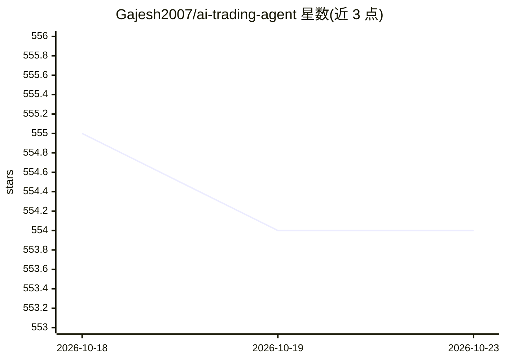

# Gajesh2007/ai-trading-agent

⭐ — · [GitHub]() · 个人维护

**在 Hyperliquid 上用 LLM 分析行情并自动执行交易的代理**

面向加密货币交易者的 Python 自动交易代理：通过 OpenRouter 调用 LLM，读取 TAAPI 的技术指标（EMA、RSI 等，经 tool calling 动态获取），对指定资产按配置间隔做出买入/卖出/持有决策，并在 Hyperliquid 去中心化交易所下单，管理止盈止损仓位。运行时提供本地 API 查看 JSONL 交易日记与日志；支持 Docker 运行及部署到 EigenCloud 的可信执行环境（TEE）。需配置 TAAPI、OpenRouter API key 与 Hyperliquid 私钥，README 声明代码未经审计。

## 筛选速览

| 维度 | 判定 | 备注 |
|---|---|---|
| AI 角色 | `ai-native` | 本体是模型或模型工具 |
| 许可风险 | `none` | — |
| 部署形态 | `self-host` | docker 或自建部署 |
| 模型依赖 | locked-api |  |
| 硬件要求 | — | 无带数字的原话,不猜 |
| 安装摩擦 | `low` | 无编译、无系统依赖或容器化 |
| 成熟度 | — | 结构信号不足 |

## 能力要点

- LLM 经 tool calling 动态获取 TAAPI 技术指标做交易决策
- 在 Hyperliquid DEX 执行交易并管理止盈止损
- 运行时提供本地 API 查看交易日记与 LLM 请求日志
- 支持 Docker 与 EigenCloud TEE 部署（EigenX CLI）

## 适用场景

- 自动化监控 BTC/ETH 等资产并按技术指标自动交易
- 对比不同 LLM 模型的实盘交易表现（Live Agents 展示）
- 在可信执行环境中部署交易代理以隔离私钥

## 场景标签

`金融量化` · 领域:学习与行业

## 证据(README 行号)

> L3: This project implements an AI-powered trading agent that leverages LLM models to analyze real-time market data from 
> L25: - `src/agent/decision_maker.py`: LLM logic for trade decisions (OpenRouter with tool calling for TAAPI indicators).

## 星数曲线

2026-10-18 555 → 2026-10-23 554（-1）

---
*卡片 v1 · prompt 1.4 · 生成 2026-10-21 · 置信度 high · 依据 README sha `5cdd01b2f19b` · [字段定义](../../DATASET.md)*
