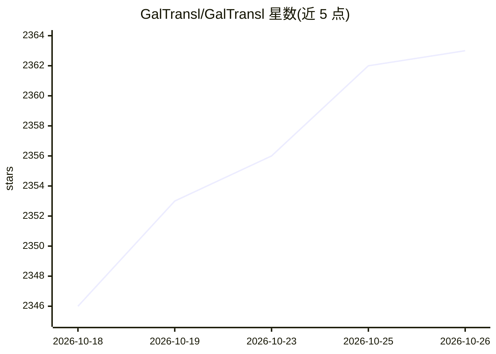

# GalTransl/GalTransl

⭐ 2,363 · Python · GPL-3.0 · 推送 2026-10-25 · [GitHub](https://github.com/GalTransl/GalTransl) · 组织维护 · 中文 README

**用大模型自动翻译 Galgame 台词并制作内嵌翻译补丁的桌面工具**

面向视觉小说汉化场景的自动化翻译流水线：读取 name-message 格式 JSON，调用 GPT/Claude/Deepseek/Sakura 等大模型完成日译中，通过 GPT 字典注入人设与术语、译前/译后/条件字典、规则化自动找错与翻译缓存断点续翻保障流程可修正。现提供 Tauri+React 桌面端，并新增 Agent 模式（自然语言驱动、含译后校对子 Agent）。配合 VNTextPatch、注入框架等外部工具完成解包到回写全流程；也支持 srt/lrc/vtt/epub 等文件直接翻译，并发布本地模型 GalTransl-7B/14B。

## 筛选速览

| 维度 | 判定 | 备注 |
|---|---|---|
| AI 角色 | `ai-native` | 本体是模型或模型工具 |
| 许可风险 | `viral` | GPL-3.0 |
| 部署形态 | `desktop` | 安装包/桌面程序 |
| 模型依赖 | locked-api |  |
| 硬件要求 | — | 无带数字的原话,不猜 |
| 安装摩擦 | `medium` | 含编译或系统依赖之一 |
| 成熟度 | — | 结构信号不足 |

## 能力要点

- 桌面端图形界面（Tauri+React）+ Agent 模式自然语言驱动翻译流程
- GPT 字典注入角色人设，译前/译后/条件字典系统
- 翻译缓存、断点续翻与规则化自动找错
- 配套本地模型 GalTransl-7B/14B（6G VRAM 以上可部署）

## 适用场景

- 我想给一款 Galgame 制作内嵌中文机翻补丁
- 我需要用字典固定人名和术语的翻译质量
- 我想让 AI Agent 自主推进并校对整个翻译任务

## 场景标签

`AI 写作` · 领域:内容生成

## 证据(README 行号)

> L3:  支持GPT/Claude/Deepseek/Sakura等大语言模型的Galgame自动化翻译解决方案
> L7:  GalTransl是一套将数个基础功能上的改进与对GPT提示工程（Prompt Engineering）的深度利用相结合的Galgame自动化翻译工具，用于制作内嵌式翻译补丁。现在提供**桌面端图形界面**，无需命令行操作即可完成
> L45: * 2026.8: 更新v8，新增Agent模式，由AI自主完成翻译流程

## 星数曲线

2026-10-18 2,346 → 2026-10-26 2,363（+17）

---
*卡片 v1 · prompt 1.4 · 生成 2026-10-21 · 置信度 mid · 依据 README sha `88cc989c98ce` · [字段定义](../../DATASET.md)*
