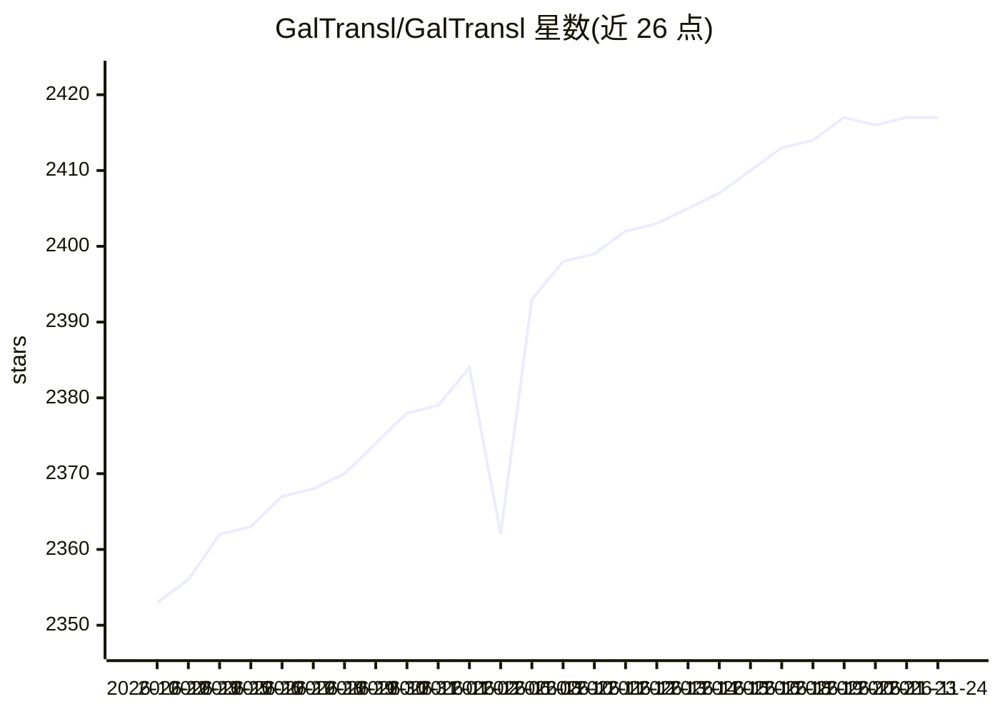

# GalTransl/GalTransl

⭐ 2,418 · Python · GPL-3.0 · 推送 2026-11-24 · [GitHub](https://github.com/GalTransl/GalTransl) · 组织维护 · 中文 README

**为Galgame汉化者提供基于大语言模型的自动化翻译流水线**

GalTransl是一套面向视觉小说的自动化翻译工具，核心是自动化翻译流水线：提取脚本为JSON后调用大语言模型翻译，再回写为内嵌翻译补丁。提供基于Tauri+React的桌面图形界面与命令行两种运行方式，支持GPT字典、译前/译后/条件字典、翻译缓存断点续翻、自动化找错与批量重翻，并支持Agent模式自主推进提取与翻译流程。使用本工具发布未校对补丁时要求标注AI翻译补丁。

## 筛选速览

| 维度 | 判定 | 备注 |
|---|---|---|
| AI 角色 | `ai-native` | 本体是模型或模型工具 |
| 许可风险 | `viral` | GPL-3.0 |
| 部署形态 | `desktop` | 安装包/桌面程序 |
| 模型依赖 | locked-api |  |
| 硬件要求 | — | 无带数字的原话,不猜 |
| 安装摩擦 | `medium` | 含编译或系统依赖之一 |
| 成熟度 | — | 结构信号不足 |

## 能力要点

- 支持GPT/Claude/Deepseek/Sakura等模型与OpenAI兼容接口
- GPT字典系统可定义人名与人设，配合译前/译后/条件字典
- 翻译缓存、断点续翻、自动化找错与按问题批量重翻
- 桌面端提供提取Agent，可自动识别引擎并提取/回写台词

## 适用场景

- 把Galgame脚本提取后自动翻译为中文并制作内嵌补丁
- 直接翻译srt、lrc、vtt、mtool json、t++ excel、epub文件
- 部署GalTransl-7B/14B本地模型进行视觉小说翻译
- 通过字典固定人名译法并修正常见翻译问题

## 场景标签

`AI 写作` `Agent 框架` · 领域:Agent 开发

## 证据(README 行号)

> L7:  GalTransl是一套将数个基础功能上的改进与对GPT提示工程（Prompt Engineering）的深度利用相结合的Galgame自动化翻译工具，用于制作内嵌式翻译补丁。现在提供**桌面端图形界面**，无需命令行操作即可完成
> L26: &ensp;&ensp;&ensp;&ensp;GalTransl的核心是一组自动化翻译流水线，解决了使用ChatGPT自动化翻译Gal过程中已知的大部分问题，并提高了整体的翻译质量。同时，通过与其他项目的组合，打通了制作补丁的完

## 星数曲线

2026-10-22 2,353 → 2026-11-24 2,417（+64）

---
*卡片 v1 · prompt 1.4 · 生成 2026-11-23 · 置信度 mid · 依据 README sha `4a47d0f29ef3` · [字段定义](../../DATASET.md)*
