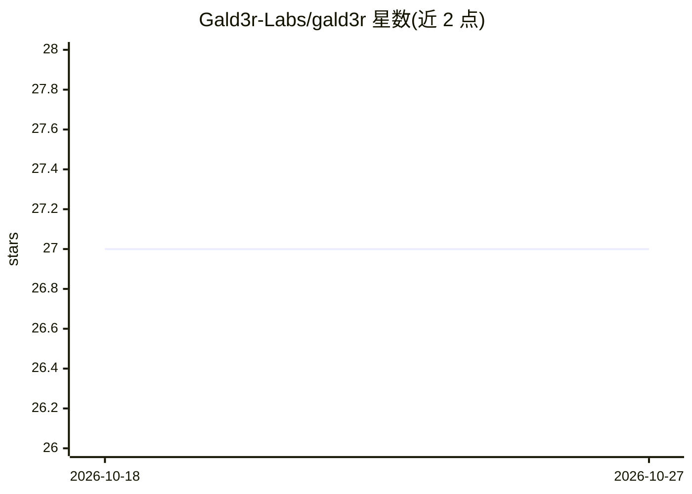

# Gald3r-Labs/gald3r

⭐ 27 · Python · NOASSERTION · 推送 2026-09-20 · [GitHub](https://github.com/Gald3r-Labs/gald3r) · [官网](https://www.gald3r.ai/) · 组织维护

**给多个 AI 编程工具共享的持久化任务/计划“大脑”引擎**

在项目仓库中创建 .gald3er/ 目录，以纯 markdown 文件存放任务、bug、计划与约束，供 Claude Code、Cursor、Copilot 等 38 个 AI 编程工具读写同一份状态。提供确定性 CLI 引擎（零 LLM 调用）、平台 overlay 生成、无头驱动 Claude Code/Cursor 的自主流水线，以及对接 Ollama、LM Studio、OpenRouter 等本地/云端模型后端。分发形式为签名安装包（msi/pkg/tar.gz）与二进制压缩包，覆盖 Windows/macOS/Linux；桌面端含 Throne 控制中心与 IDE 编辑器（Intel Mac 不提供桌面应用）。Linux 桌面应用需自行安装 WebKit2GTK 4.1，安装器不运行 sudo。README 另宣告将推出 3D 化 AI 团队直播功能（COMING SOON）。

## 筛选速览

| 维度 | 判定 | 备注 |
|---|---|---|
| AI 角色 | `ai-ecosystem` | LLM/agent 周边工具 |
| 许可风险 | `none` | NOASSERTION |
| 部署形态 | `desktop` | 安装包/桌面程序 |
| 模型依赖 | local-ok | 支持本地模型 |
| 硬件要求 | — | 无带数字的原话,不猜 |
| 安装摩擦 | `low` | 无编译、无系统依赖或容器化 |
| 成熟度 | — | 结构信号不足 |

## 能力要点

- 38 个 AI 编程工具共享同一 .gald3er/ 任务板与约束文件
- 确定性引擎执行常规流程，零 LLM 调用；无账号/服务器/数据库/Docker
- gald3er platform install 一条命令为各平台生成 overlay
- 支持 Ollama/LM Studio/OpenRouter/Unsloth 等本地与云端模型后端

## 适用场景

- 在 Cursor 里做计划、在 Claude Code 里继续编码而不丢上下文
- 把任务、bug 与约束持久在 git 历史中供 AI 与团队成员读取
- 用无头模式驱动 AI 编程工具跑自主流水线

## 场景标签

`Agent 框架` `Agent 记忆` · 领域:Agent 开发

## 证据(README 行号)

> L110: gald3r puts a `.gald3r/` folder in your project — plain markdown files for tasks, bugs,

## 星数曲线

2026-10-18 27 → 2026-10-27 27（+0）

---
*卡片 v1 · prompt 1.4 · 生成 2026-10-26 · 置信度 high · 依据 README sha `66aebebc3398` · [字段定义](../../DATASET.md)*
