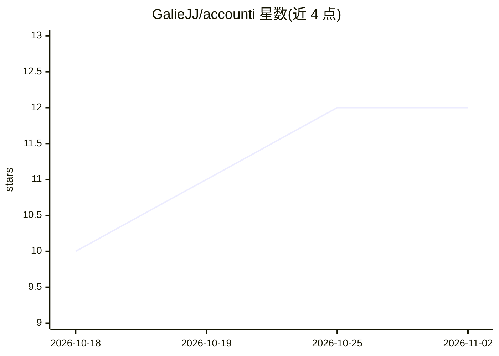

# GalieJJ/accounti

⭐ 12 · Python · MIT · 推送 2026-10-26 · [GitHub](https://github.com/GalieJJ/accounti) · 个人维护

**面向德国中小企业的自托管开源会计记账自动化系统**

面向德国中小企业本地部署（Self-Hosted）的开源记账系统：从邮件/文件夹/电子发票采集凭证，经 FinTS/CSV 自动获取银行流水，按 SKR03/SKR04 会计科目规则加 LLM 辅助自动分类（附置信度与理由），生成会计分录、BWA 报表与 DATEV 兼容导出文件；覆盖应收应付、SEPA 付款、催款、增值税预申报、固定资产折旧等功能。采用规则优先、LLM 辅助、人工审核模式：不确定项交人工复核，修正结果转化为规则形成学习闭环；所有操作以哈希链写入不可变日记账。需 Python 3.11+、PostgreSQL 15+ 与 LLM 接入（Anthropic/OpenAI/本地 Ollama），Java 21 与 Tesseract 为可选依赖。项目处于活跃开发期，Quickstart 描述的是目标形态。

## 筛选速览

| 维度 | 判定 | 备注 |
|---|---|---|
| AI 角色 | `ai-enhanced` | 去掉 AI 部分产品仍成立 |
| 许可风险 | `permissive` | MIT |
| 部署形态 | `self-host` | docker 或自建部署 |
| 模型依赖 | local-ok | 支持本地模型 |
| 硬件要求 | — | 无带数字的原话,不猜 |
| 安装摩擦 | `low` | 无编译、无系统依赖或容器化 |
| 成熟度 | `idea` | |

## 能力要点

- SKR03/SKR04 科目分类采用规则引擎+可选 LLM，带置信度与理由，人工修正转为规则
- 哈希链式不可变日记账，含角色、一次性密码与四眼原则审批
- DATEV EXTF 格式凭证包与会计分录批量导出，另提供 /api/v1 REST API
- docker compose 运行，含 PostgreSQL、加密备份与定期计划任务

## 适用场景

- 德国中小企业在自有服务器上完成从凭证录入到期末报表的全流程记账
- 自动分类银行流水并按 DATEV 格式导出给税务顾问
- 电子发票（XRechnung/ZUGFeRD）合规校验与开具
- 通过 REST API 从 ERP/外部系统批量递交凭证

## 场景标签

 · 领域:财务/会计软件

## 证据(README 行号)

> L5:  KI-gestützte Buchhaltungsautomatisierung für deutsche Unternehmen
> L18: **accounti** macht die laufende Buchhaltung kleiner und mittlerer Unternehmen in Deutschland im eigenen Haus möglic
> L59: |✅|**KI-Kontierung**|SKR03/SKR04-Zuordnung per Regelwerk + LLM, mit Confidence und Begründung|

## 星数曲线

2026-10-18 10 → 2026-11-02 12（+2）

---
*卡片 v1 · prompt 1.4 · 生成 2026-11-01 · 置信度 mid · 依据 README sha `42bc6259f44d` · [字段定义](../../DATASET.md)*
