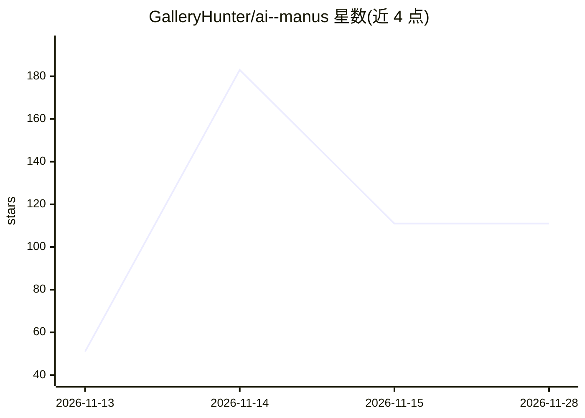

# GalleryHunter/ai--manus

⭐ 111 · Apache-2.0 · 推送 2026-11-15 · [GitHub](https://github.com/GalleryHunter/ai--manus) · 个人维护

**面向日常任务的自主 AI Agent：代用户执行代码与操控浏览器**

README 以产品宣传口吻描述 Manus 自主 AI 代理：可代用户编写并执行脚本、打开网页、与页面元素交互、执行多步骤任务，代码与浏览器操作可在同一流程中衔接。定位为家庭、学习与轻量办公场景的后台个人助手，明确声明非企业级平台。给出系统兼容性表（最低双核 CPU、4 GB 内存）与使用步骤说明，但未见源码、安装命令或 API 接入方式，仅提供下载入口与优惠码，实际实现与主题标签（function-calling、多模型）无法从 README 正文验证。

## 筛选速览

| 维度 | 判定 | 备注 |
|---|---|---|
| AI 角色 | `ai-native` | 本体是模型或模型工具 |
| 许可风险 | `permissive` | Apache-2.0 |
| 部署形态 | `None` |  |
| 模型依赖 | — | README 未给出锁定关系 |
| 硬件要求 | — | 无带数字的原话,不猜 |
| 安装摩擦 | `low` | 无编译、无系统依赖或容器化 |
| 成熟度 | — | 结构信号不足 |

## 能力要点

- 自主执行代码与浏览器操控，支持多步骤任务
- 代码与浏览器操作可在同一工作流中衔接
- 面向家庭、学习与轻量办公的小规模场景
- README 给出系统兼容性要求（最低双核 CPU / 4 GB 内存）

## 适用场景

- 让代理代为填写表单、抓取网页信息
- 整理研究笔记、运行小脚本等日常小任务
- 远程支持中重排诊断步骤与检查系统页面

## 场景标签

`AI 助手` `工作流自动化` `浏览器自动化` · 领域:效率与自动化

## 证据(README 行号)

> L18: Manus is an autonomous AI agent designed to run code and control a browser on your behalf. Instead of acting like a
> L22: Manus is not a heavy studio suite or a complex enterprise platform. It is a focused helper built for home, study, a

## 星数曲线

2026-11-13 51 → 2026-11-28 111（+60）

---
*卡片 v1 · prompt 1.4 · 生成 2026-11-17 · 置信度 mid · 依据 README sha `a3d88e202bf0` · [字段定义](../../DATASET.md)*
