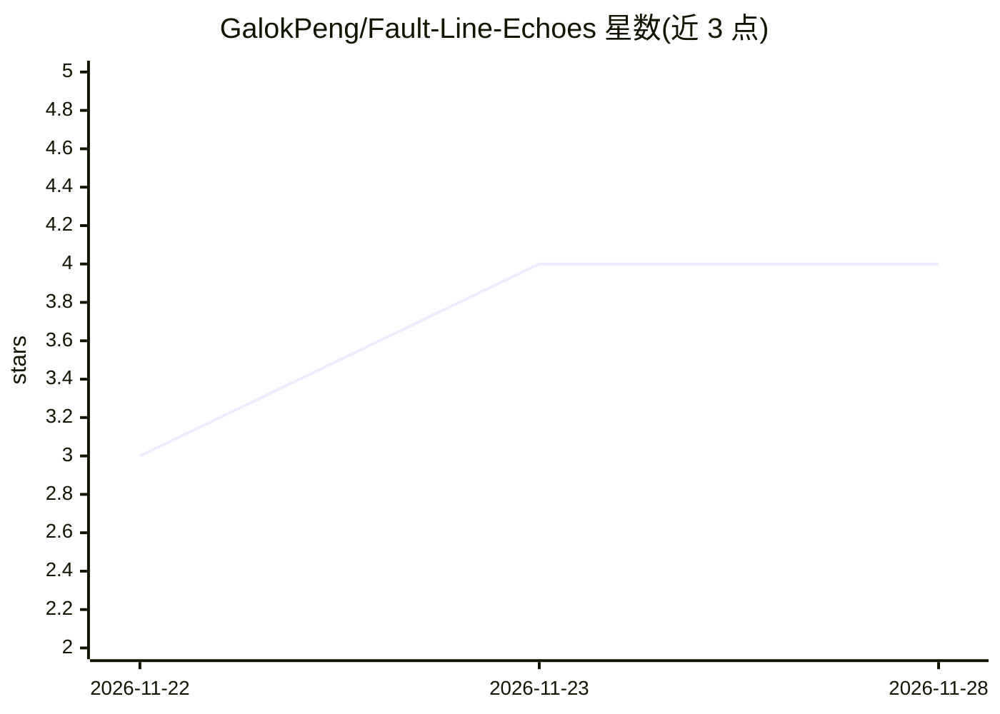

# GalokPeng/Fault-Line-Echoes

⭐ 4 · JavaScript · MIT · 推送 2026-11-19 · [GitHub](https://github.com/GalokPeng/Fault-Line-Echoes) · [官网](https://fault-line-echoes.vercel.app) · 个人维护 · 中文 README

**浏览器 3D 冒险游戏及供 agent 构建自有游戏世界的技能包**

包含两部分：一是可在浏览器运行的第一人称冒险游戏 Fault Line Echoes（中文游玩），含首都白砥城与四个野外区域、四名可操作角色（各 4 技能）、九章节主线与十二个支线任务、生存/狩猎/制作/背包系统，以及基于六位房间码与 WebRTC/中继的双人决斗与协作巡逻。二是一个可安装的 agent skill（build-game-world），放入 .agents/skills/ 后在 Codex 中调用，按用户的玩家行为与决策描述生成可玩的单文件 HTML 或在线联机版本，并含美术资产（GLB/glTF、特效图集）接入流程与固定版本引用的 Python 辅助脚本。

## 筛选速览

| 维度 | 判定 | 备注 |
|---|---|---|
| AI 角色 | `ai-native` | 本体是模型或模型工具 |
| 许可风险 | `permissive` | MIT |
| 部署形态 | `None` |  |
| 模型依赖 | — | README 未给出锁定关系 |
| 硬件要求 | — | 无带数字的原话,不猜 |
| 安装摩擦 | `low` | 无编译、无系统依赖或容器化 |
| 成熟度 | — | 结构信号不足 |

## 能力要点

- installable agent skill：将描述转换为可玩单文件 HTML 游戏或在线联机版本
- 完整技术示例：四区域地图、四角色 16 技能、三人称/第一人称渲染与物理
- 双人联机：六位房间码邀请，same-origin HTTPS 中继升级到 WebRTC，主机裁决
- 美术协作交接流程：GLB/glTF 模型、特效图集的预检与游戏内验证

## 适用场景

- 在浏览器中直接游玩第一人称冒险战役或与好友双人对战
- 用自然语言让 agent 生成一个自己的单文件或联机小游戏
- 将角色/特效美术资产交给 agent 集成进可玩游戏中

## 场景标签

`代码生成` · 领域:编码与开发

## 证据(README 行号)

> L3:  An original first-person browser adventure and an installable agent skill for building a game world of your own.
> L11: Tell the agent **what the player does, which choice is difficult and what changes afterward**. You can speak Englis
> L13: **Install.** Open the bilingual guide, choose **Download the skill**, unzip it and put the entire `build-game-world

## 星数曲线

2026-11-22 3 → 2026-11-28 4（+1）

---
*卡片 v1 · prompt 1.4 · 生成 2026-11-22 · 置信度 high · 依据 README sha `702c043666bb` · [字段定义](../../DATASET.md)*
