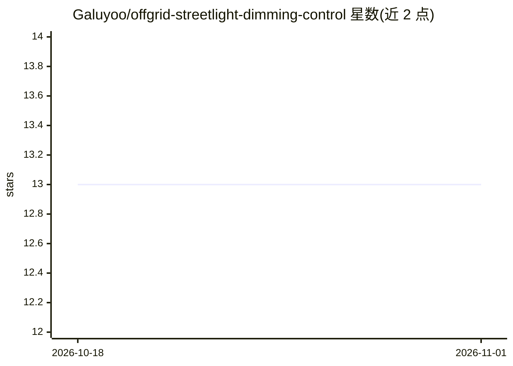

# Galuyoo/offgrid-streetlight-dimming-control

⭐ 13 · Jupyter Notebook · MIT · 推送 2026-08-14 · [GitHub](https://github.com/Galuyoo/offgrid-streetlight-dimming-control) · 组织维护

**论文复现代码：离网太阳能路灯调光控制与电池续航预测**

提供《Sustainable Energy Technologies and Assessments》论文的可复现代码与 Jupyter 笔记本：基于 NASA 电池数据集构建分组训练/测试划分，用随机森林预测电池续航，结合残差分位数不确定性缓冲生成分时段调光策略，并计算停电率、节能与 UM|BO 严重度指标、可行性边界与重复运行置信区间。数据集需自行从 NASA 或 Kaggle 下载，主入口为 03 复现笔记本，含 light 至 heavy 多档运行模式。

## 筛选速览

| 维度 | 判定 | 备注 |
|---|---|---|
| AI 角色 | `ai-native` | 本体是模型或模型工具 |
| 许可风险 | `permissive` | MIT |
| 部署形态 | `library` | 以包/库形式分发 |
| 模型依赖 | — | README 未给出锁定关系 |
| 硬件要求 | — | 无带数字的原话,不猜 |
| 安装摩擦 | `low` | 无编译、无系统依赖或容器化 |
| 成熟度 | — | 结构信号不足 |

## 能力要点

- 随机森林续航预测 + 残差分位数不确定性缓冲
- 分时段调光策略仿真与可行性边界估计
- 停电率/节能/UM|BO 严重度指标与重复运行置信区间
- 多档运行模式（light/review_fast/medium/heavy 等）

## 适用场景

- 复现论文核心结果与消融分析
- 做电池约束下离网照明调光策略研究
- 基于 NASA 电池数据做续航预测实验

## 场景标签

 · 领域:能源/离网光伏系统

## 证据(README 行号)

> L15: This repository contains the reproducibility code and supporting research notebooks for the paper:
> L27: - Random Forest runtime forecasting

## 星数曲线

2026-10-18 13 → 2026-11-01 13（+0）

---
*卡片 v1 · prompt 1.4 · 生成 2026-11-01 · 置信度 high · 依据 README sha `a3de5468c33f` · [字段定义](../../DATASET.md)*
