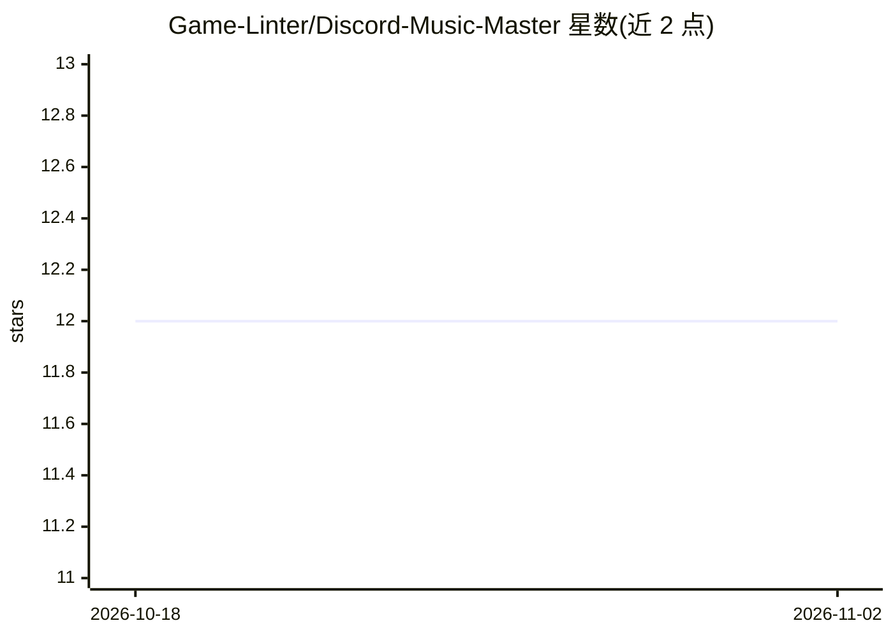

# Game-Linter/Discord-Music-Master

⭐ 12 · TypeScript · AGPL-3.0 · 推送 2026-02-15 · [GitHub](https://github.com/Game-Linter/Discord-Music-Master) · [官网](https://top.gg/bot/724010668751323196) · 组织维护

**Discord 音乐点播机器人：支持自动连播推荐与歌词**

基于 discord.js/TypeScript 的 Discord 音乐机器人，接受 YouTube 搜索/链接/公开播放列表及 Spotify 曲目、播放列表、专辑链接作为输入，提供播放、插播、暂停、跳过、队列洗牌、单曲循环、歌词获取等命令，并可用 __save/__load 按服务器保存和加载播放列表。队列清空时默认开启的自动播放会继续播放与当前曲目相关和推荐的音乐，形成连续电台式体验。提供 Docker 镜像，也可克隆源码后用 yarn 安装依赖并配置凭据运行。

## 筛选速览

| 维度 | 判定 | 备注 |
|---|---|---|
| AI 角色 | `ai-enhanced` | 去掉 AI 部分产品仍成立 |
| 许可风险 | `viral` | AGPL-3.0 |
| 部署形态 | `self-host` | docker 或自建部署 |
| 模型依赖 | — | README 未给出锁定关系 |
| 硬件要求 | — | 无带数字的原话,不猜 |
| 安装摩擦 | `low` | 无编译、无系统依赖或容器化 |
| 成熟度 | — | 结构信号不足 |

## 能力要点

- 支持 YouTube 搜索/URL/公开播放列表与 Spotify 曲目/播放列表/专辑链接输入
- 队列清空时自动播放相关与推荐歌曲（默认开启）
- 按服务器保存/加载播放列表（__save/__load）
- 提供歌词获取命令（存在时）

## 适用场景

- 在 Discord 语音频道点播 YouTube/Spotify 音乐
- 让机器人自动连播推荐歌曲当背景电台
- 保存并重复加载服务器的常用播放列表

## 场景标签

 · 领域:聊天机器人/音乐娱乐

## 证据(README 行号)

> L22:  Play almost any type of songs
> L66:  <code>The bot will keep playing related and recommended music to the currently playing track, as long as the queue
> L72:  Autoplay which is enabled by default

## 星数曲线

2026-10-18 12 → 2026-11-02 12（+0）

---
*卡片 v1 · prompt 1.4 · 生成 2026-11-01 · 置信度 mid · 依据 README sha `d040a169142e` · [字段定义](../../DATASET.md)*
