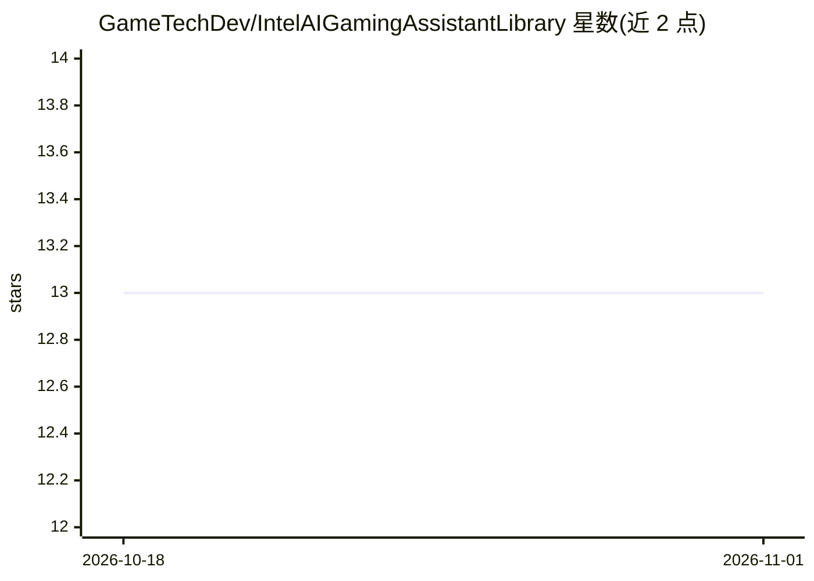

# GameTechDev/IntelAIGamingAssistantLibrary

⭐ 13 · 推送 2026-09-17 · [GitHub](https://github.com/GameTechDev/IntelAIGamingAssistantLibrary) · 组织维护 · 中文 README

**游戏内 AI 助手的本地推理后端服务，含视觉/RAG/ASR/OCR**

运行于 Windows 的本地 AI 后端服务，为游戏内智能辅助提供 HTTP API（默认端口 9190）：截图场景识别与图像检索、密集+BM25 混合检索与重排的 RAG 问答、多模态检索、持久化对话记忆、带热词的语音识别、截图 OCR 以及 Boss 动作识别。推理通过 OpenVINO IR 格式模型在 Intel GPU/NPU 上加速，模型不随发行包捆绑，需自行下载或转换，ModelScope 下载脚本仅供个人评估使用。

## 筛选速览

| 维度 | 判定 | 备注 |
|---|---|---|
| AI 角色 | `ai-native` | 本体是模型或模型工具 |
| 许可风险 | `none` | — |
| 部署形态 | `desktop` | 安装包/桌面程序 |
| 模型依赖 | — | README 未给出锁定关系 |
| 硬件要求 | — | 无带数字的原话,不猜 |
| 安装摩擦 | `low` | 无编译、无系统依赖或容器化 |
| 成熟度 | — | 结构信号不足 |

## 能力要点

- 截图理解、多模态检索、RAG 问答（dense+BM25 混合检索与重排）、记忆管理等模块化能力
- 本地 HTTP API 供客户端集成，全程在设备端运行
- 推理经 OpenVINO IR 格式模型在 Intel GPU/NPU 上加速，LLM/嵌入/重排模型可替换
- OCR 采用 PaddleOCR 风格模型转换至 OpenVINO IR 格式

## 适用场景

- 为游戏客户端接入截图理解、语音识别与知识库问答等 AI 能力
- 在 Intel 平台上构建设备端的游戏智能辅助功能
- 通过本地 HTTP API 调用 RAG 问答与多模态检索服务

## 场景标签

`RAG` `语音识别` `多模态` `OCR` · 领域:知识与检索

## 证据(README 行号)

> L5: Intel® AI Gaming Assistant Library is an AI-powered local backend service that enables in-game intelligent assistanc
> L10: - **Knowledge Base** — RAG pipeline with hybrid retrieval (dense + BM25), reranking, and LLM-based Q&A, with option

## 星数曲线

2026-10-18 13 → 2026-11-01 13（+0）

---
*卡片 v1 · prompt 1.4 · 生成 2026-10-31 · 置信度 high · 依据 README sha `c2d72a4061a4` · [字段定义](../../DATASET.md)*
