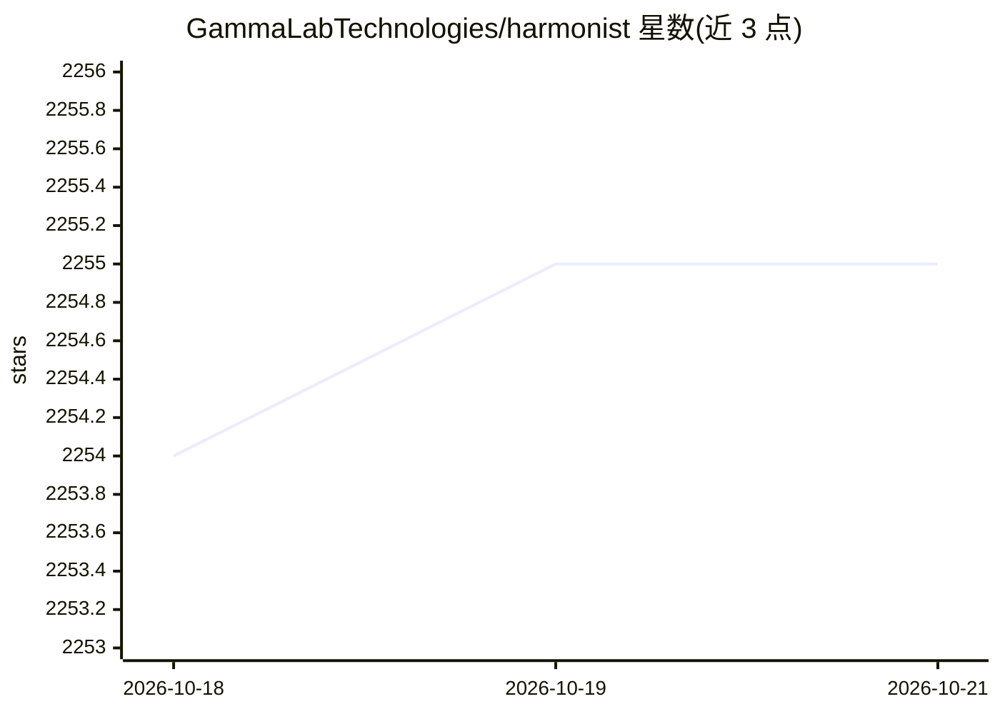

# GammaLabTechnologies/harmonist

⭐ 2,255 · Python · MIT · 推送 2026-06-09 · [GitHub](https://github.com/GammaLabTechnologies/harmonist) · [官网](https://gammalab.ae) · 组织维护 · 中文 README

**面向 AI 编码助手的多 agent 编排框架，钩子强制执行协议**

以 git clone 子目录形式嵌入用户项目的多 agent 编排框架，供 Cursor、Claude Code、Copilot、Windsurf、Aider 等支持子 agent 派发的 AI 编码助手使用。提供 193 个领域专家 agent（16 类）、由 IDE 级钩子（stop/beforeShellExecution 等）做机制化协议门控、MANIFEST.sha256 供应链校验、带 schema 校验与密钥扫描的持久记忆。纯 Python stdlib，零第三方依赖，Windows/macOS/Linux 原生运行；无安装器，集成通过粘贴集成提示词或运行 integrate.py 完成。

## 筛选速览

| 维度 | 判定 | 备注 |
|---|---|---|
| AI 角色 | `ai-ecosystem` | LLM/agent 周边工具 |
| 许可风险 | `permissive` | MIT |
| 部署形态 | `None` |  |
| 模型依赖 | — | README 未给出锁定关系 |
| 硬件要求 | — | 无带数字的原话,不猜 |
| 安装摩擦 | `low` | 无编译、无系统依赖或容器化 |
| 成熟度 | — | 结构信号不足 |

## 能力要点

- stop 钩子机制化门控：审查未完成则阻止回合完成
- MANIFEST.sha256 校验 agent 定义文件供应链
- 193 个领域专家 agent，按 domains×roles×tags 数据驱动路由
- 纯 Python stdlib 零运行时依赖，跨平台原生运行

## 适用场景

- 在 Cursor 等编码助手中强制执行审查、QA 等非协商规则
- 为项目按领域挑选专家 agent 组成多 agent 工作流
- 跨会话持久化状态与决策记忆

## 场景标签

`Agent 框架` `多智能体` · 领域:Agent 开发

## 证据(README 行号)

> L11: *A drop-in multi-agent framework for Cursor, Claude Code, Copilot, Windsurf, Aider, and other AI coding assistants.
> L59: implemented as IDE-level hooks — concrete shell and Python scripts that

## 星数曲线

2026-10-18 2,254 → 2026-10-21 2,255（+1）

---
*卡片 v1 · prompt 1.4 · 生成 2026-10-21 · 置信度 high · 依据 README sha `74e8e5e6da52` · [字段定义](../../DATASET.md)*
