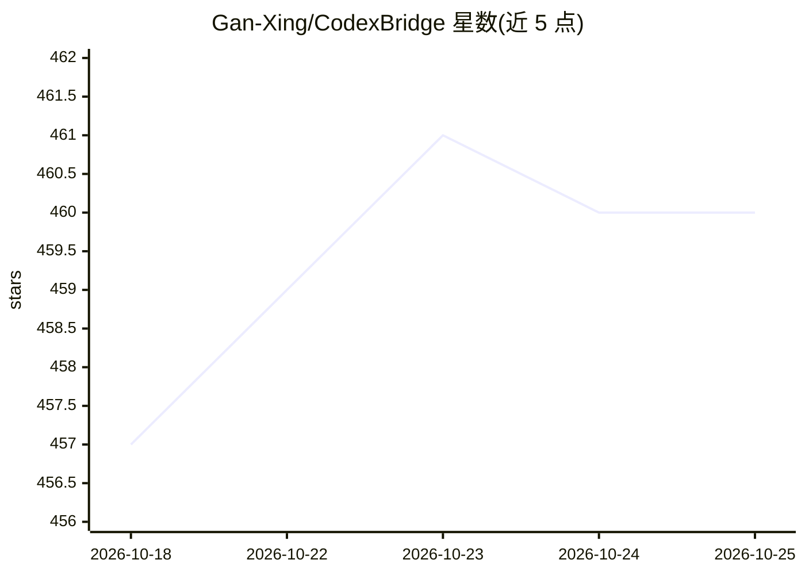

# Gan-Xing/CodexBridge

⭐ 460 · TypeScript · 推送 2026-06-24 · [GitHub](https://github.com/Gan-Xing/CodexBridge) · [官网](https://github.com/Gan-Xing/CodexBridge#readme) · 个人维护 · 中文 README

**把微信聊天接入共享 Codex 引擎的桥接网关**

TypeScript 实现的网关，将微信等聊天平台作为适配器连接到宿主机上的 Codex 引擎（Codex CLI / app-server），Codex 线程状态为唯一事实来源。提供 40+ 条微信斜杠命令（会话路由、审批、计划模式、模型切换、自动化任务、日志/待办/提醒等助手记录），支持文件上传与 JSON 持久化。内置 OpenAI 兼容 Responses 适配器，可将 DeepSeek、MiniMax、Qwen、OpenRouter、Kimi、Gemini 等非 OpenAI 提供方接入 Codex。需要 Node.js >= 24 与宿主机 Codex CLI 登录；部分包（codex-gateway、mission-control）处于暂停状态。

## 筛选速览

| 维度 | 判定 | 备注 |
|---|---|---|
| AI 角色 | `ai-ecosystem` | LLM/agent 周边工具 |
| 许可风险 | `none` | — |
| 部署形态 | `desktop` | 安装包/桌面程序 |
| 模型依赖 | — | README 未给出锁定关系 |
| 硬件要求 | — | 无带数字的原话,不猜 |
| 安装摩擦 | `medium` | 含编译或系统依赖之一 |
| 成熟度 | — | 结构信号不足 |

## 能力要点

- 40+ 条微信友好斜杠命令覆盖会话、审批、自动化与助手记录
- OpenAI 兼容 Responses 适配器支持 DeepSeek/MiniMax/Qwen/OpenRouter/Kimi/Gemini 等提供方
- Codex 线程状态作为唯一事实源，多聊天平台共享同一引擎
- /as 自然语言管理日志、待办、提醒与笔记，含草稿确认流程

## 适用场景

- 在微信里通过斜杠命令使用 Codex 进行编码与代码审查
- 用自然语言创建定时任务并把结果发回微信
- 把非 OpenAI 提供方（如 DeepSeek/Qwen）通过适配器接入 Codex

## 场景标签

`聊天机器人` · 领域:对话与助手

## 证据(README 行号)

> L3: CodexBridge is a Codex-centered gateway for connecting multiple chat platforms to one shared Codex engine, while swi
> L48: - Codex profile loader and initial Codex app-server client/plugin path for shared thread execution
> L151: - CodexBridge can expose non-OpenAI providers through a local Responses adapter while Codex app-server still talks

## 星数曲线

2026-10-18 457 → 2026-10-25 460（+3）

---
*卡片 v1 · prompt 1.4 · 生成 2026-10-21 · 置信度 high · 依据 README sha `1b1ba79c41c2` · [字段定义](../../DATASET.md)*
