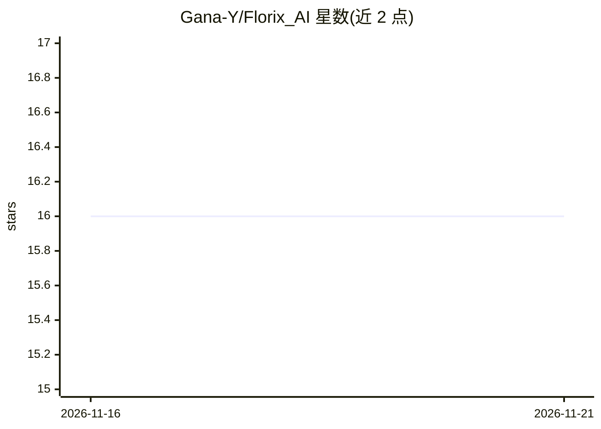

# Gana-Y/Florix_AI

⭐ 16 · JavaScript · MIT · 推送 2026-11-20 · [GitHub](https://github.com/Gana-Y/Florix_AI) · [官网](https://florix-4rkmoj877-ganesh-y-s-projects.vercel.app) · 个人维护

**面向学生的异步多模态 RAG 学习平台，含口试模拟与间隔重复**

Florix AI 是面向学生/学习者教育的多模态 RAG 应用：将科学 PDF、教科书、YouTube 讲座转录、网页文章、语音笔记和代码片段转化为向量库，支持 HNSW 索引检索（ChromaDB）、两级 Redis 语义缓存、Google Gemini 嵌入与生成。功能包括基于 Bloom 分类的交互式口试模拟、SuperMemo-2 间隔重复调度、错误分类与补救训练，并通过 PostgreSQL（15+ 表）记录学习遥测。前后端分离（React 19 + FastAPI），提供 Make 一键启动与手动开发两种方式。

## 筛选速览

| 维度 | 判定 | 备注 |
|---|---|---|
| AI 角色 | `ai-native` | 本体是模型或模型工具 |
| 许可风险 | `permissive` | MIT |
| 部署形态 | `library` | 以包/库形式分发 |
| 模型依赖 | — | README 未给出锁定关系 |
| 硬件要求 | — | 无带数字的原话,不猜 |
| 安装摩擦 | `low` | 无编译、无系统依赖或容器化 |
| 成熟度 | — | 结构信号不足 |

## 能力要点

- 多模态摄取管线：PDF/教科书/YouTube 转录/语音/代码片段统一向量化
- ChromaDB HNSW 索引（M=16, ef_search=40）与两级 Redis 语义缓存
- 基于 Bloom 分类的交互式口试引擎与多维度评分矩阵
- SuperMemo-2 间隔重复调度与错误分类补救训练

## 适用场景

- 把教材、讲义和视频转录整理成可检索的个人知识库
- 通过语音口试模拟检验对课程内容的掌握程度
- 按间隔重复计划复习抽认卡并跟踪学习数据

## 场景标签

`知识库管理` `文档问答` `多模态` · 领域:知识与检索

## 证据(README 行号)

> L14: **Florix AI** is an enterprise-grade, asynchronous multimodal **Retrieval-Augmented Generation (RAG)** platform. It
> L104: * **High-Density Vectorization:** 3072-dimensional vector coordinates via Google `gemini-embedding-2`.

## 星数曲线

2026-11-16 16 → 2026-11-21 16（+0）

---
*卡片 v1 · prompt 1.4 · 生成 2026-11-18 · 置信度 high · 依据 README sha `039262e79176` · [字段定义](../../DATASET.md)*
