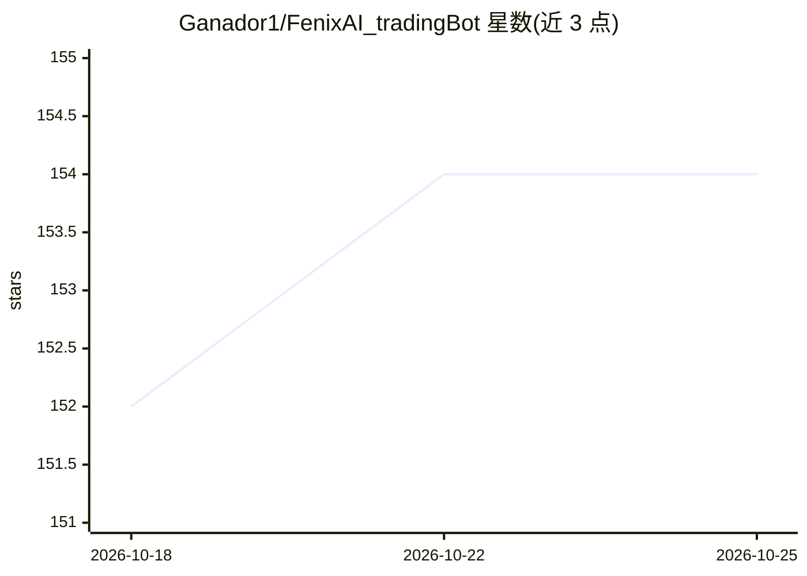

# Ganador1/FenixAI_tradingBot

⭐ 154 · Python · Apache-2.0 · 推送 2026-08-08 · [GitHub](https://github.com/Ganador1/FenixAI_tradingBot) · [官网](https://ko-fi.com/ganador) · 个人维护

**面向 Binance 合约的多 agent 加密货币自动交易机器人**

基于 LangGraph 编排多个专职 AI agent（Technical、QABBA、Sentiment、Visual、Risk、Decision）并行分析市场并在 Binance Futures 执行交易；配套 NanoFenix 经典 ML 伴随模型做信号过滤（含漂移触发的在线重训练与分 regime 元标注）、ReasoningBank 自进化记忆、FastAPI+React 仪表盘、纸面/实盘双模式。LLM 提供云端与本地（如 Ollama）可配置切换。README 声明项目仍在活跃开发、尚未证明盈利，建议先纸面交易。

## 筛选速览

| 维度 | 判定 | 备注 |
|---|---|---|
| AI 角色 | `ai-native` | 本体是模型或模型工具 |
| 许可风险 | `permissive` | Apache-2.0 |
| 部署形态 | `self-host` | docker 或自建部署 |
| 模型依赖 | local-ok | 支持本地模型 |
| 硬件要求 | — | 无带数字的原话,不猜 |
| 安装摩擦 | `low` | 无编译、无系统依赖或容器化 |
| 成熟度 | `idea` | |

## 能力要点

- LangGraph 并行多 agent 图（Technical/QABBA/Sentiment/Visual + Risk/Decision）
- NanoFenix 经典 ML 伴随信号：Page-Hinkley 漂移触发重训练、分 regime 元标注
- 封闭 K 线指标缓冲与订单对账等数据完整性修复
- 提示注入防护与确定性宏观风险控制

## 适用场景

- 在 Binance 合约上运行多 agent 自动交易（先纸面模式验证）
- 通过仪表盘查看每个交易决策与被否决原因
- 用本地 LLM（如 Ollama）替代云端提供推理服务

## 场景标签

`多智能体` `金融量化` · 领域:Agent 开发

## 证据(README 行号)

> L3: ### Autonomous Multi-Agent Cryptocurrency Trading System with Self-Evolving Memory
> L20: *An advanced trading system powered by multiple specialized AI agents that collaborate to analyze markets, manage r
> L137: |**Parallel agent graph**|Technical, QABBA, Sentiment, and Visual run in true parallel via LangGraph; background c

## 星数曲线

2026-10-18 152 → 2026-10-25 154（+2）

---
*卡片 v1 · prompt 1.4 · 生成 2026-10-22 · 置信度 low · 依据 README sha `ae1072e1755e` · [字段定义](../../DATASET.md)*
