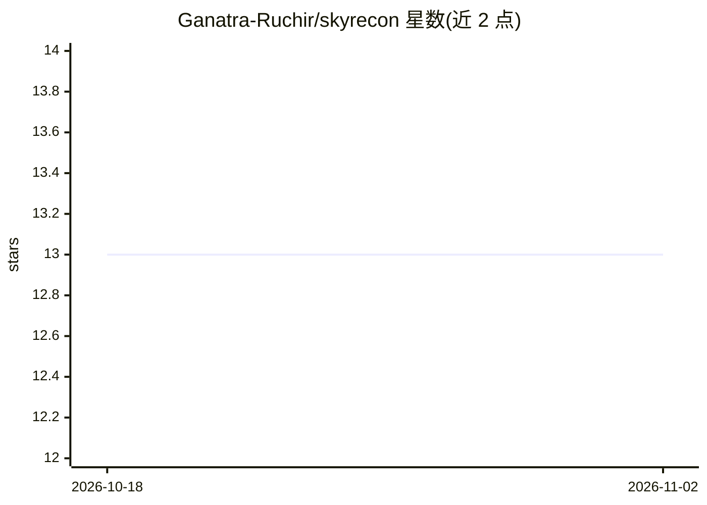

# Ganatra-Ruchir/skyrecon

⭐ 13 · Python · MIT · 推送 2026-10-19 · [GitHub](https://github.com/Ganatra-Ruchir/skyrecon) · [官网](https://skyrecon-neon.vercel.app) · 个人维护

**威胁情报与检测平台：加密库上做 IOC 提取、规则检测与异常发现**

面向安全分析师和蓝队的 Python(FastAPI)+React 威胁检测平台。从粘贴的威胁报告中提取 IOC（去重、剔除内网/文档段等误杀源），按 30 天半衰期做置信度衰减与富化评分，每步调整附解释语句；检测侧提供手写递归下降解析的规则表达式语言（无 eval/exec），以及 Isolation Forest（可选）/纯 Python z-score 的异常模型。数据库采用 AES-256-GCM 信封加密、哈希链审计日志、盲索引，并有测试验证磁盘文件不可恢复明文。支持 STIX 2.1/MISP/CSV 导出与 MITRE ATT&CK 映射。限制：单写者、限流器与异常模型持有进程内状态，横向扩展需先迁移限流到 Redis。

## 筛选速览

| 维度 | 判定 | 备注 |
|---|---|---|
| AI 角色 | `ai-native` | 本体是模型或模型工具 |
| 许可风险 | `permissive` | MIT |
| 部署形态 | `self-host` | docker 或自建部署 |
| 模型依赖 | — | README 未给出锁定关系 |
| 硬件要求 | — | 无带数字的原话,不猜 |
| 安装摩擦 | `low` | 无编译、无系统依赖或容器化 |
| 成熟度 | — | 结构信号不足 |

## 能力要点

- IOC 提取含去重与 RFC1918/CGN/文档段等排除逻辑
- 检测规则经递归下降解析器执行，规则字符串无代码执行路径
- Isolation Forest 或纯 Python z-score 异常模型捕获规则外事件
- AES-256-GCM 信封加密 + 哈希链审计日志 + 密钥轮换，测试验证静态数据不可恢复

## 适用场景

- 粘贴威胁报告自动提取、评分并管理 IOC
- 接入遥测事件，用可读规则与异常模型产生带解释的告警
- 以 STIX/MISP/CSV 格式导出指标供其他安全工具使用
- 隔离环境（air-gapped）下用单文件控制台离线分析报告

## 场景标签

`网络安全` · 领域:学习与行业

## 证据(README 行号)

> L58: **An anomaly model for what the rules miss.** Isolation Forest when scikit-learn is installed, a
> L59: pure-Python z-score baseline when it is not, over six features of every event. In the seeded demo it
> L32: You paste a threat report. SkyRecon pulls the indicators out of it, throws away the ones that would

## 星数曲线

2026-10-18 13 → 2026-11-02 13（+0）

---
*卡片 v1 · prompt 1.4 · 生成 2026-10-31 · 置信度 mid · 依据 README sha `da6c2cad1c05` · [字段定义](../../DATASET.md)*
